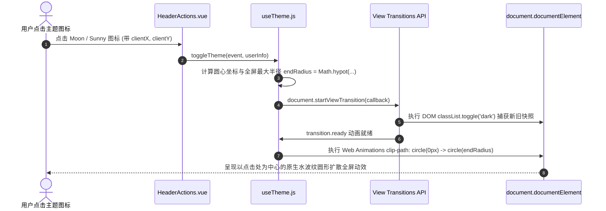

# 前端后台管理系统框架现代化重构与组件规范手册

> **工程使命**：对标主流现代化中后台开源标杆（Geeker-Admin、Pure-Admin、Vben-Admin），彻底重构单体臃肿布局，消除一切零散兼容性代码，建立大厂级布局分层、Design Tokens、全屏圆形扩散暗黑模式与通用业务组件封装体系。

---

## 一、 整体任务进度追踪看板

### ✅ 阶段一：Layout 布局中枢重塑与现代化动效（已全部落地验收）

* [x] **单体 `home.vue` 全面解耦**：将原近 500 行的臃肿单体架构彻底拆解至 `src/layout/` 模块化目录，`home.vue` 收敛为纯净顶级代理入口；
* [x] **侧边栏系统 (`src/layout/components/Sidebar`)**：
  * [x] 品牌 Logo 组件 [`Logo.vue`](file:///e:/nest/mynest1/vue-vite/vue-vite/src/layout/components/Sidebar/Logo.vue)：自适应折叠展开，支持暗黑模式自适应与平滑淡入淡出；
  * [x] 递归多级菜单 [`SidebarItem.vue`](file:///e:/nest/mynest1/vue-vite/vue-vite/src/layout/components/Sidebar/SidebarItem.vue)：无限层级树形自解析、Element Plus 动态图标容错映射、消除硬编码；
  * [x] 侧边栏总控 [`index.vue`](file:///e:/nest/mynest1/vue-vite/vue-vite/src/layout/components/Sidebar/index.vue)：`el-scrollbar` 深度整合，折叠过渡动画平滑收放 (210px ↔ 64px)；
* [x] **顶栏系统 (`src/layout/components/Header`)**：
  * [x] 动态面包屑导航 [`Breadcrumb.vue`](file:///e:/nest/mynest1/vue-vite/vue-vite/src/layout/components/Header/Breadcrumb.vue)：根据当前路由 `route.matched` 动态追踪层级，内置首页常驻与平滑淡入动效；
  * [x] 顶栏功能集 [`HeaderActions.vue`](file:///e:/nest/mynest1/vue-vite/vue-vite/src/layout/components/Header/HeaderActions.vue)：集成全屏切换 (FullScreen)、用户头像与退出登录二次确认；
  * [x] 顶栏总控 [`index.vue`](file:///e:/nest/mynest1/vue-vite/vue-vite/src/layout/components/Header/index.vue)：标准化 50px 高度规范，彻底清除原 90px 硬编码与内边距错乱问题；
* [x] **Element Plus / VitePress 官网同款 View Transitions 暗黑扩散动效（精细化调优）**：
  * [x] 全局图层动画样式 [`theme-transition.css`](file:///e:/nest/mynest1/vue-vite/vue-vite/src/assets/css/theme-transition.css)：精准修复 `::view-transition-old/new` 伪元素 z-index 层级反转 Bug，确保新旧图层不发生误遮挡；
  * [x] 组合式函数 [`useTheme.js`](file:///e:/nest/mynest1/vue-vite/vue-vite/src/composables/useTheme.js)：基于 `document.startViewTransition` 捕获点击圆心，通过 `Math.hypot` 计算全屏最大半径，精准映射 `pseudoElement` 分发扩散与收缩动画；
  * [x] **彻底根除 F5 刷新白闪 (Zero Flash / Anti-FOUC)**：在 [`index.html`](file:///e:/nest/mynest1/vue-vite/vue-vite/index.html) 的 `<head>` 中注入首屏阻塞式同步脚本，首帧渲染前强制完成 `class="dark"` 嗅探与注入，时间差缩减至 0ms，彻底消除白屏晃眼；
* [x] **多标签栏导航 TagsView (`src/layout/components/Tabs`)**：
  * [x] 标签栏总控 [`index.vue`](file:///e:/nest/mynest1/vue-vite/vue-vite/src/layout/components/Tabs/index.vue)：卡片风格扁平化重构，支持固定首页不可关闭；
  * [x] 右键菜单与更多操作：支持刷新当前、关闭当前、关闭左侧、关闭右侧、关闭其他、全部关闭，并计算视口边界彻底杜绝溢出屏幕；
* [x] **主体内容区 (`src/layout/components/Main`)**：
  * [x] 内容区总控 [`index.vue`](file:///e:/nest/mynest1/vue-vite/vue-vite/src/layout/components/Main/index.vue)：移除脆弱的 `<transition mode="out-in">` 规避业务页面多根节点 (Vue 3 Fragment) 渲染白屏 Bug，恢复原生稳定且高性能的 `<router-view>`；
  * [x] 无感局部刷新机制：通过 `reloadCurrentRoute()` 驱动单路由重载，免去整页白屏重刷；
* [x] **暗黑模式 Design Tokens 体系与业务硬编码治理（核心样板落地）**：
  * [x] 全局变量中枢 [`css-vars.css`](file:///e:/nest/mynest1/vue-vite/vue-vite/src/assets/css/dark/css-vars.css)：定义两套自适应变量（基础卡片、AI 审查紫金渐变卡片、特批放行/驳回横幅、时间轴条目与评论框等）；
  * [x] 标杆业务组件治理 [`ApprovalDrawer.vue`](file:///e:/nest/mynest1/vue-vite/vue-vite/src/pages/workbench/components/ApprovalDrawer.vue)：彻底替换 `.ai-audit-card`、`.special-approval-tip-box`、`.workflow-steps` 等近 20 处写死的 Hex 颜色为 CSS 变量，树立全系统暗黑模式业务组件迁移标杆；
  * [x] 动态表单运行时治理 [`SubformWidget.vue`](file:///e:/nest/mynest1/vue-vite/vue-vite/src/pages/formDesign/components/widgets/SubformWidget.vue) & [`SubformRowItem.vue`](file:///e:/nest/mynest1/vue-vite/vue-vite/src/pages/formDesign/components/widgets/SubformRowItem.vue)：彻底消除容器、表格模式、明细行卡片的硬编码颜色；
  * [x] **LogicFlow 流程设计器全链路暗黑模式无缝联动（攻坚完成）**：
    * [x] 底层 Hook 改造 [`useLogicFlow.js`](file:///e:/nest/mynest1/vue-vite/vue-vite/src/pages/workflowDesigner/hooks/useLogicFlow.js)：实现透明自适应画布背景，导出 `getLogicFlowTheme` 与 `applyTheme` 动态主题驱动接口；
    * [x] SVG 节点模型重构 [`customNodes.js`](file:///e:/nest/mynest1/vue-vite/vue-vite/src/pages/workflowDesigner/customNodes.js)：开始节点、结束节点、审批节点、条件网关、AI审查节点全面根据 `isDark` 动态切换 SVG `fill`、`stroke` 及 `text` 颜色；
    * [x] 流程设计器总控 [`logicFlow.vue`](file:///e:/nest/mynest1/vue-vite/vue-vite/src/pages/workflowDesigner/logicFlow.vue)：通过 `watch(isDark)` 实现全局主题切换时画布与所有节点的实时重绘；并重构 DndPanel、Toolbar、Control、Menu 与抽屉样式接入 Design Tokens；
  * [x] **动态表单设计器主界面治理 [`formDesign.vue`](file:///e:/nest/mynest1/vue-vite/vue-vite/src/pages/formDesign/formDesign.vue)**：全面对齐 Sidebar 的 `var(--el-border-color-lighter)` 边框标准体系，替换物料栏、设计画布、右侧属性面板的所有硬编码边框与背景。

---

### ⏳ 阶段二：系统高级偏好设置与多布局架构引擎（明日单位重点攻坚）

* [ ] **偏好设置总控中心与状态持久化 (`src/stores/modules/layout.js`)**：
  * [ ] 建立基于 Pinia 的响应式布局配置 Store，统一收敛布局模式、主色、功能开关、动效控制等全量状态；
  * [ ] 实现与 `localStorage` 的自动化双向同步，确保页面刷新与重载后偏好配置 0 延迟秒级复原；
  * [ ] 提供“恢复默认设置”一键重置机制。
* [ ] **四大布局引擎矩阵解耦与动态装配 (`src/layout/`)**：
  * [ ] `vertical` **纵向经典模式**（默认）：左侧垂直导航菜单 + 顶栏面包屑与快捷工具，适用于绝大部分后台系统；
  * [ ] `columns` **分栏双列模式**：最左侧为一级图标极窄栏 (60px)，次列为二级/三级树形子菜单栏 (200px)，支持子栏独立折叠，专为超复杂大中型业务系统定制；
  * [ ] `horizontal` **横向通栏模式**：无左侧边栏，菜单全部收敛于 50px 顶栏，内容区全宽铺满，最大化横向可视空间；
  * [ ] `mixed` **综合混合模式**：顶栏展示系统一级模块导航，左侧边栏联动展示当前激活模块的二级/三级子菜单。
* [ ] **系统主题与动态品牌色盘调色器 (Theme & Color Scheme)**：
  * [ ] 主题模式扩展：纯净明亮 (Light) / 极夜暗黑 (Dark) / 跟随系统 (System OS)；
  * [ ] 品牌主色调色盘 (Primary Color Matrix)：预设 6 款高质感品牌色（经典科技蓝 `#409EFF`、翡翠绿 `#10B981`、极光紫 `#8B5CF6`、活力橙 `#F97316`、中国红 `#EF4444`、青金石蓝 `#0ea5e9`），支持拾色器自定义；
  * [ ] 动态色彩阶梯算法 (Token Generator)：基于 RGB/HSL 算法自动实时推导 `--el-color-primary-light-1` 至 `light-9` 以及 `--el-color-primary-dark-2`，批量注入 `:root`，实现全系统 0 刷新瞬时换肤；
  * [ ] 侧边栏/顶栏反转色配置（深色侧边栏 vs 纯白侧边栏独立控制）。
* [ ] **界面功能与交互显隐控制 (UI Controls)**：
  * [ ] 面包屑导航显隐 (`showBreadcrumb`) 与图标显隐 (`showBreadcrumbIcon`) 开关；
  * [ ] 多标签栏 TagsView 显隐 (`showTabs`)、图标显隐与三种风格切换（圆角卡片 / 胶囊 / 极简无框）；
  * [ ] 侧边栏折叠按钮显隐与悬浮控制；
  * [ ] 路由页面转场动画切换（无动效 / 淡入淡出 `fade` / 缩放滑动 `fade-transform`）；
  * [ ] 特殊辅助模式：全站灰色哀悼模式 (`filter: grayscale(1)`)、色弱无障碍模式 (`filter: invert(80%)`)。
* [ ] **设置抽屉组件 (`src/layout/components/SettingDrawer/index.vue`)**：
  * [ ] 顶栏 [`HeaderActions.vue`](file:///e:/nest/mynest1/vue-vite/vue-vite/src/layout/components/Header/HeaderActions.vue) 接入 ⚙️ 设置齿轮入口；
  * [ ] 研发高质感右侧滑出抽屉，包含“布局架构缩略图选择器”、“主题色彩矩阵”、“界面功能开关组”与“重置配置”。

---

### ⏳ 阶段三：业务开发提效核心三大件封装（待推进）

* [ ] **`ProTable` 超级表格组件 + `useTable` 组合式函数**：
  * [ ] 传入 `requestApi` 异步函数，内置分页、Loading 状态、空数据兜底；
  * [ ] 表头右侧集成“刷新表格”、“列显隐配置”、“紧凑/常规密度切换”三大工具栏；
  * [ ] 彻底消灭每个页面重复编写的 `el-pagination` 与 `pageSize/currentPage`。
* [ ] **`SearchForm` 高级搜索筛选栏**：
  * [ ] 基于响应式栅格布局（Grid）；
  * [ ] 超过 3 项自动提供【展开/收起】切换；
  * [ ] 内置【查询】（回车防抖触发）与【重置】（自动清空并触发表格重新加载）。
* [ ] **`ProDialog` / `ProDrawer` 弹窗与抽屉增强容器**：
  * [ ] 统一 Header、Body 滚动容器与 Footer；
  * [ ] 支持一键切换全屏最大化 (Maximize) 与拖拽移动；
  * [ ] 确认按钮内置 `confirm-loading`，异步表单提交未结束时自动保持 Loading 并禁用关闭。

---

### ⏳ 阶段四：细节体验微组件封装（待推进）

* [ ] **`PageContainer` 统一页面卡片外壳**：为所有业务页面提供统一的内边距、阴影、背景色与自适应高度；
* [ ] **`StatusTag` 状态字典标签**：自动根据字典值映射圆点状态标签（成功绿、警告橙、危险红、禁用灰）；
* [ ] **`CopyText` 一键复制文本组件**：单号/密钥/ID 旁快捷复制，带 Tooltip 与成功提示反馈；
* [ ] **`AvatarUpload` 统一头像图片上传器**：内聚尺寸校验、图片压缩、圆形预览与加载失败防裂兜底。

---

### ⏳ 阶段五：工程目录与代码规范纠偏（待推进）

* [ ] 将拼写错误的 `src/stortes/` 目录平移重命名为标准的 `src/stores/`；
* [ ] 清理 `src/style.css` 中残留的 Vite 初始模版未用代码；
* [ ] 规范 UnoCSS 与 Element Plus 主题变量的配合使用。

---

## 二、 核心架构设计详解

### 1. View Transitions API 暗黑模式圆形扩散动效原理解析



### 2. Layout 模块化分层目录拓扑

```text
src/
├── layout/                                # 🌟 核心分层布局系统
│   ├── index.vue                          # 布局总装配 (ElContainer, 动态匹配布局引擎, 局部无感刷新总控)
│   ├── layout-vertical.vue                # 纵向经典布局外壳
│   ├── layout-columns.vue                 # 分栏双列布局外壳
│   ├── layout-horizontal.vue              # 横向通栏布局外壳
│   ├── layout-mixed.vue                   # 综合混合布局外壳
│   └── components/
│       ├── Sidebar/                       # 侧边栏子系统 (纵向/混合)
│       │   ├── index.vue                  # 侧边栏外壳 (滚动容器, 210px <-> 64px 宽度过渡)
│       │   ├── Logo.vue                   # 品牌 Logo 标题 (折叠平滑过渡)
│       │   └── SidebarItem.vue            # 递归多级菜单 (树形深度解析, 图标自闭环)
│       ├── ColumnsAside/                  # 🌟 分栏双列特有组件
│       │   ├── index.vue                  # 60px 一级大图标导航 + 200px 二级菜单抽屉折叠
│       ├── Header/                        # 顶栏子系统 (标准 50px 高度)
│       │   ├── index.vue                  # 顶栏外壳 (集成横向一级/通栏菜单联动)
│       │   ├── Breadcrumb.vue             # 动态面包屑 (自适应 route.matched)
│       │   └── HeaderActions.vue          # 操作集 (偏好设置 ⚙️、View Transitions 暗黑扩散、全屏、个人中心退出)
│       ├── Tabs/                          # 多标签栏 TagsView (标准 38px 高度)
│       │   └── index.vue                  # 多标签导航 (首页固定、右侧更多菜单、边界保护右键菜单)
│       ├── SettingDrawer/                 # 🌟 全局高级偏好设置抽屉
│       │   └── index.vue                  # 布局切换矩阵、色盘调色器、功能开关、一键重置
│       └── Main/                          # 路由内容区
│           └── index.vue                  # 页面主容器 (fade-transform 路由转场、无感刷新 key)
│
├── stores/modules/
│   └── layout.js                          # 🌟 布局与主题偏好响应式中枢 (Pinia + LocalStorage 持久化)
│
├── composables/                           # 🌟 组合式函数
│   ├── useTheme.js                        # 全局主题控制 (View Transitions 原生全屏扩散)
│   └── useColorGenerator.js               # 🌟 主题色梯度推导算法 (自动生成 primary-light-1~9 / dark-2)
│
└── assets/css/
    └── theme-transition.css               # View Transitions 伪元素图层动画样式
```

### 3. 系统高级偏好设置与多布局架构引擎设计


#### 四大布局架构矩阵对比

| 布局模式 (`layoutMode`) | 核心结构特征 | 菜单组织形式 | 适用业务场景 |
| :--- | :--- | :--- | :--- |
| **`vertical` (纵向经典)** | 左侧全高侧边栏 + 顶栏导航与面包屑 | 左侧树形菜单收缩展开 (210px ↔ 64px) | 通用中后台业务系统，层级通常为 2~3 级 |
| **`columns` (分栏双列)** | 左侧 60px 极窄栏 + 200px 次级菜单栏 | 极窄栏仅放一级模块大图标，次级栏展开下级树，支持单独折叠 | 超大型企业级 ERP/CRM，模块极多、功能分类深 |
| **`horizontal` (横向通栏)** | 无左侧栏，纯顶栏通栏 (50px) + 内容区 | 顶栏横向水平展示各级下拉菜单，全宽延展 | 数据可视化大屏中控、看板监控、横向超宽报表 |
| **`mixed` (综合混合)** | 顶栏一级菜单 + 左侧联动展示次级菜单 | 顶栏展示一级业务域，点击后左侧自动切换其对应树形子路由 | 平台型综合系统，多系统集成统一门户 |

#### 品牌主色阶梯算法设计 (Dynamic Primary Color Tokens)
为确保全站 Element Plus 组件与自研业务组件风格 100% 浑然一体，切换主色时采用纯算法推导，免除编写海量繁杂 CSS：
- **亮色阶梯**：以所选主色与白色 (`#ffffff`) 进行加权线性插值，公式为：`color(weight) = round(primary * (1 - weight) + 255 * weight)`，生成 `--el-color-primary-light-1` 至 `light-9`；
- **暗色阶梯**：以所选主色与黑色 (`#000000`) 进行加权混合，生成 `--el-color-primary-dark-2`，作为按钮 Hover 与聚焦激活态；
- **响应式注入**：通过 `document.documentElement.style.setProperty` 实时覆盖，瞬时生效无感知。

---

### 4. 关键体验攻坚技术复盘沉淀

#### 攻坚 A：F5 刷新白屏一闪 (Zero Flash / Anti-FOUC) 根除方案
* **问题本质**：SPA 应用的 Vue 运行时与 Pinia 状态为异步下载并执行。在未执行前，浏览器默认以白底渲染首次 Paint，导致暗黑模式下 F5 刷新必有一瞬间白光闪烁（FOUC, Flash of Unstyled Content）。
* **工程解法**：在 [`index.html`](file:///e:/nest/mynest1/vue-vite/vue-vite/index.html) 的 `<head>` 最顶部注入内联极简同步脚本：
  ```html
  <script>
    (function () {
      const isDark = localStorage.getItem('THEME_MODE') === 'dark' || 
        (!localStorage.getItem('THEME_MODE') && window.matchMedia('(prefers-color-scheme: dark)').matches);
      if (isDark) document.documentElement.classList.add('dark');
    })();
  </script>
  ```
  在浏览器生成 DOM 树与 CSSOM 首帧前强制打上 `class="dark"`，实现 **0 延迟、0 闪白**。

#### 攻坚 B：LogicFlow 流程设计器暗黑模式全链路穿透
* **问题本质**：`@logicflow/core` 底层 CSS 强制写死了 `.lf-graph { background: #fff; }`，且节点由 SVG 渲染，颜色内聚在 Model 的 JavaScript 对象中，无法仅靠普通 CSS 级联继承变色。
* **工程解法**：
  1. CSS 强力覆盖：在 [`css-vars.css`](file:///e:/nest/mynest1/vue-vite/vue-vite/src/assets/css/dark/css-vars.css) 中以 `!important` 穿透压制 `.lf-graph` 为 `var(--el-bg-color-page)`，背景网格点阵自动动态变色；
  2. SVG Model 动态感知：在 [`customNodes.js`](file:///e:/nest/mynest1/vue-vite/vue-vite/src/pages/workflowDesigner/customNodes.js) 中所有节点 Model 根据当前主题状态动态返回对应的深色渐变、暗色描边与高亮文字；
  3. 响应式联动重绘：在 [`logicFlow.vue`](file:///e:/nest/mynest1/vue-vite/vue-vite/src/pages/workflowDesigner/logicFlow.vue) 中监听主题变更，实时调用 `applyTheme` 刷新画布所有图元。

---

## 三、 暗黑模式设计规范与 Design Tokens 适配手册（业务开发红线）

### 1. 痛点根因分析（软件工程视角）
在中后台业务开发中，开发者习惯在 `<style>` 中随手硬编码静态 Hex 颜色（如 `background: #ffffff`, `#f8fafc`, `color: #334155`）。
当全屏切换为 `html.dark` 时，全局主背景虽然变黑，但局部业务卡片由于拥有更高特异性的写死颜色声明，仍然强行渲染白底浅灰，导致页面严重割裂、刺眼甚至文字看不清。

### 2. 双层治理规范体系

| 分类 | 适用场景 | 推荐 Token / CSS 变量 | 严禁写法 ❌ |
| :--- | :--- | :--- | :--- |
| **容器背景** | 通用卡片、内容面板底色 | `var(--el-bg-color)`、`var(--app-card-bg)` | `#fff`、`#ffffff` |
| **浅灰底衬** | 列表底色、标签备注、单人条目 | `var(--el-fill-color-light)`、`var(--app-timeline-item-bg)` | `#f8fafc`、`#f5f7fa` |
| **边框线条** | 卡片边框、步骤条分割线 | `var(--el-border-color-lighter)`、`var(--app-timeline-item-border)` | `#e2e8f0`、`#ebeef5` |
| **主要文字** | 标题、姓名、重要内容 | `var(--el-text-color-primary)`、`var(--app-text-main)` | `#1e293b`、`#303133` |
| **常规/次要** | 描述段落、时间轴详情、时间戳 | `var(--el-text-color-regular)`、`var(--el-text-color-secondary)` | `#475569`、`#64748b` |
| **特色业务卡片** | AI 智能审查卡片 (渐变、边框、阴影) | `var(--app-ai-card-bg)`、`var(--app-ai-card-border)` | 局部写死紫渐变/浅紫底 |
| **审批说明横幅** | 特批放行 / 驳回 说明横幅 | `var(--app-tip-pass-bg)`、`var(--app-tip-reject-bg)` | 局部写死 `#fdf6ec` 等浅底 |

### 3. 标准迁移样板：[`ApprovalDrawer.vue`](file:///e:/nest/mynest1/vue-vite/vue-vite/src/pages/workbench/components/ApprovalDrawer.vue)
- 审查报告 `.ai-audit-card`：`background: var(--app-ai-card-bg)`，在暗黑模式下呈现深邃暗紫金质感；
- 结论框 `.ai-summary-box`：`background: var(--app-ai-box-bg); color: var(--app-ai-box-text)`，黑夜模式柔和对比；
- 时间轴节点 `.workflow-steps`：标题与内容分别使用 `var(--el-text-color-primary)` 与 `var(--el-text-color-regular)`，黑夜下字体自然提亮。
