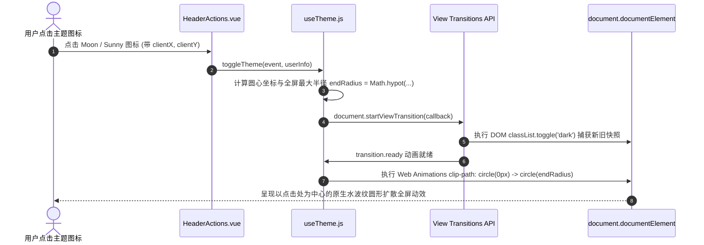
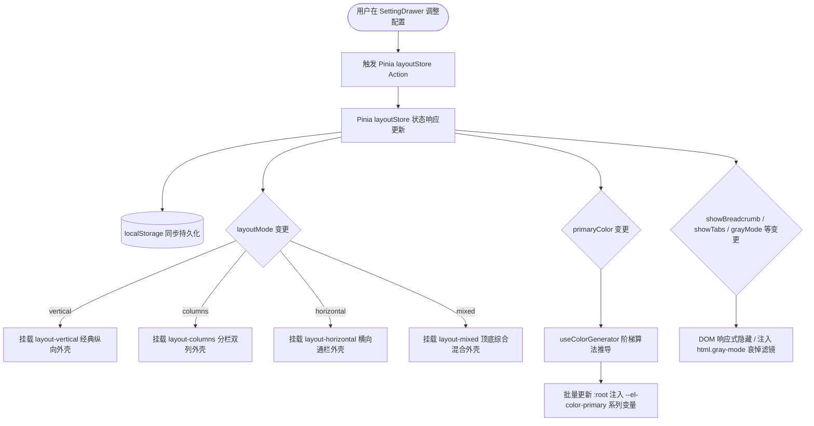
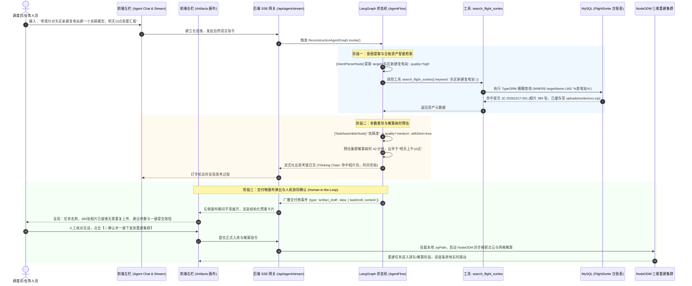

# 前端后台管理系统框架现代化重构与组件规范手册

> **工程使命**：对标主流现代化中后台开源标杆（Geeker-Admin、Pure-Admin、Vben-Admin），彻底重构单体臃肿布局，消除一切零散兼容性代码，建立大厂级布局分层、Design Tokens、全屏圆形扩散暗黑模式与通用业务组件封装体系。

---

## 一、 整体任务进度追踪看板

### ✅ 阶段一：Layout 布局中枢重塑与现代化动效（已全部落地验收）

* [x] **单体 `home.vue` 全面解耦**：将原近 500 行的臃肿单体架构彻底拆解至 `src/layout/` 模块化目录，`home.vue` 收敛为纯净顶级代理入口；
* [x] **侧边栏系统 (`src/layout/components/Sidebar`)**：
  * [x] 品牌 Logo 组件 [`Logo.vue`](file:///e:/nest/mynest1/vue-vite/vue-vite/src/layout/components/Sidebar/Logo.vue)：自适应折叠展开，支持暗黑模式自适应与平滑淡入淡出；
  * [x] 递归多级菜单 [`SidebarItem.vue`](file:///e:/nest/mynest1/vue-vite/vue-vite/src/layout/components/Sidebar/SidebarItem.vue)：无限层级树形自解析、Element Plus 动态图标容错映射、消除硬编码；
  * [x] 侧边栏总控 [`index.vue`](file:///e:/nest/mynest1/vue-vite/vue-vite/src/layout/components/Sidebar/index.vue)：`el-scrollbar` 深度整合，折叠过渡动画平滑收放 (210px ↔ 64px)；
* [x] **顶栏系统 (`src/layout/components/Header`)**：
  * [x] 动态面包屑导航 [`Breadcrumb.vue`](file:///e:/nest/mynest1/vue-vite/vue-vite/src/layout/components/Header/Breadcrumb.vue)：根据当前路由 `route.matched` 动态追踪层级，内置首页常驻与平滑淡入动效；
  * [x] 顶栏功能集 [`HeaderActions.vue`](file:///e:/nest/mynest1/vue-vite/vue-vite/src/layout/components/Header/HeaderActions.vue)：集成全屏切换 (FullScreen)、用户头像与退出登录二次确认；
  * [x] 顶栏总控 [`index.vue`](file:///e:/nest/mynest1/vue-vite/vue-vite/src/layout/components/Header/index.vue)：标准化 50px 高度规范，彻底清除原 90px 硬编码与内边距错乱问题；
* [x] **Element Plus / VitePress 官网同款 View Transitions 暗黑扩散动效（精细化调优）**：
  * [x] 全局图层动画样式 [`theme-transition.css`](file:///d:/xuexi/vue-vite/src/assets/css/theme-transition.css)：100% 对齐 Element Plus 官网图层层叠规范（变暗时白色旧视图置顶 z-index: 9999 收缩，变亮时白色新视图置顶 z-index: 9999 扩散）；
  * [x] 组合式函数 [`useTheme.js`](file:///d:/xuexi/vue-vite/src/composables/useTheme.js)：基于 `document.startViewTransition` 与 `await nextTick()`，白变黑时白色收拢向圆心（回缩变黑），黑变白时白色自圆心扩散至全屏（扩散变白），0 毫秒闪烁，完美还原官网质感；
  * [x] **彻底根除 F5 刷新白闪 (Zero Flash / Anti-FOUC)**：在 [`index.html`](file:///d:/xuexi/vue-vite/index.html) 的 `<head>` 中注入首屏阻塞式同步脚本，首帧渲染前强制完成 `class="dark"` 嗅探与注入，时间差缩减至 0ms，彻底消除白屏晃眼；
* [x] **多标签栏导航 TagsView (`src/layout/components/Tabs`)**：
  * [x] 标签栏总控 [`index.vue`](file:///e:/nest/mynest1/vue-vite/vue-vite/src/layout/components/Tabs/index.vue)：卡片风格扁平化重构，支持固定首页不可关闭；
  * [x] 右键菜单与更多操作：支持刷新当前、关闭当前、关闭左侧、关闭右侧、关闭其他、全部关闭，并计算视口边界彻底杜绝溢出屏幕；
  * [x] **根除全局视口原生滚动条 (Zero Outer Scrollbar)**：
    * 为 TagsView 下拉菜单与顶栏用户菜单明确指定 `placement="bottom-end"`，防止贴边菜单向右侧视口外溢出；
    * 在 [`App.vue`](file:///d:/xuexi/vue-vite/src/App.vue) 中为 `html, body, #app` 锁死 `width: 100%; height: 100%; overflow: hidden;`，彻底禁止 Teleport 浮层（Popper/Tooltip/Drawer）撑破全局视口；
    * 将 Layout 根容器由 `100vw/100vh` 优化为 `100%`，Main 内容区优化为 `flex: 1; min-height: 0;`，根除 Windows 缩放下亚像素引起的滚动条闪现。
* [x] **主体内容区 (`src/layout/components/Main`)**：
  * [x] 内容区总控 [`index.vue`](file:///e:/nest/mynest1/vue-vite/vue-vite/src/layout/components/Main/index.vue)：移除脆弱的 `<transition mode="out-in">` 规避业务页面多根节点 (Vue 3 Fragment) 渲染白屏 Bug，恢复原生稳定且高性能的 `<router-view>`；
  * [x] 无感局部刷新机制：通过 `reloadCurrentRoute()` 驱动单路由重载，免去整页白屏重刷；
* [x] **暗黑模式 Design Tokens 体系与业务硬编码治理（核心样板落地）**：
  * [x] 全局变量中枢 [`css-vars.css`](file:///e:/nest/mynest1/vue-vite/vue-vite/src/assets/css/dark/css-vars.css)：定义两套自适应变量（基础卡片、AI 审查紫金渐变卡片、特批放行/驳回横幅、时间轴条目与评论框等）；
  * [x] 标杆业务组件治理 [`ApprovalDrawer.vue`](file:///e:/nest/mynest1/vue-vite/vue-vite/src/pages/workbench/components/ApprovalDrawer.vue)：彻底替换 `.ai-audit-card`、`.special-approval-tip-box`、`.workflow-steps` 等近 20 处写死的 Hex 颜色为 CSS 变量，树立全系统暗黑模式业务组件迁移标杆；
  * [x] 动态表单运行时治理 [`SubformWidget.vue`](file:///e:/nest/mynest1/vue-vite/vue-vite/src/pages/formDesign/components/widgets/SubformWidget.vue) & [`SubformRowItem.vue`](file:///e:/nest/mynest1/vue-vite/vue-vite/src/pages/formDesign/components/widgets/SubformRowItem.vue)：彻底消除容器、表格模式、明细行卡片的硬编码颜色；
  * [x] **LogicFlow 流程设计器全链路暗黑模式无缝联动（攻坚完成）**：
    * [x] 底层 Hook 改造 [`useLogicFlow.js`](file:///e:/nest/mynest1/vue-vite/vue-vite/src/pages/workflowDesigner/hooks/useLogicFlow.js)：实现透明自适应画布背景，导出 `getLogicFlowTheme` 与 `applyTheme` 动态主题驱动接口；
    * [x] SVG 节点模型重构 [`customNodes.js`](file:///e:/nest/mynest1/vue-vite/vue-vite/src/pages/workflowDesigner/customNodes.js)：开始节点、结束节点、审批节点、条件网关、AI审查节点全面根据 `isDark` 动态切换 SVG `fill`、`stroke` 及 `text` 颜色；
    * [x] 流程设计器总控 [`logicFlow.vue`](file:///e:/nest/mynest1/vue-vite/vue-vite/src/pages/workflowDesigner/logicFlow.vue)：通过 `watch(isDark)` 实现全局主题切换时画布与所有节点的实时重绘；并重构 DndPanel、Toolbar、Control、Menu 与抽屉样式接入 Design Tokens；
  * [x] **动态表单设计器主界面治理 [`formDesign.vue`](file:///e:/nest/mynest1/vue-vite/vue-vite/src/pages/formDesign/formDesign.vue)**：全面对齐 Sidebar 的 `var(--el-border-color-lighter)` 边框标准体系，替换物料栏、设计画布、右侧属性面板的所有硬编码边框与背景。

---

### ⏳ 阶段二：系统高级偏好设置与多布局架构引擎（明日单位重点攻坚）

* [ ] **偏好设置总控中心与状态持久化 (`src/stores/modules/layout.js`)**：
  * [ ] 建立基于 Pinia 的响应式布局配置 Store，统一收敛布局模式、主色、功能开关、动效控制等全量状态；
  * [ ] 实现与 `localStorage` 的自动化双向同步，确保页面刷新与重载后偏好配置 0 延迟秒级复原；
  * [ ] 提供“恢复默认设置”一键重置机制。
* [ ] **四大布局引擎矩阵解耦与动态装配 (`src/layout/`)**：
  * [ ] `vertical` **纵向经典模式**（默认）：左侧垂直导航菜单 + 顶栏面包屑与快捷工具，适用于绝大部分后台系统；
  * [ ] `columns` **分栏双列模式**：最左侧为一级图标极窄栏 (60px)，次列为二级/三级树形子菜单栏 (200px)，支持子栏独立折叠，专为超复杂大中型业务系统定制；
  * [ ] `horizontal` **横向通栏模式**：无左侧边栏，菜单全部收敛于 50px 顶栏，内容区全宽铺满，最大化横向可视空间；
  * [ ] `mixed` **综合混合模式**：顶栏展示系统一级模块导航，左侧边栏联动展示当前激活模块的二级/三级子菜单。
* [ ] **系统主题与动态品牌色盘调色器 (Theme & Color Scheme)**：
  * [ ] 主题模式扩展：纯净明亮 (Light) / 极夜暗黑 (Dark) / 跟随系统 (System OS)；
  * [ ] 品牌主色调色盘 (Primary Color Matrix)：预设 6 款高质感品牌色（经典科技蓝 `#409EFF`、翡翠绿 `#10B981`、极光紫 `#8B5CF6`、活力橙 `#F97316`、中国红 `#EF4444`、青金石蓝 `#0ea5e9`），支持拾色器自定义；
  * [ ] 动态色彩阶梯算法 (Token Generator)：基于 RGB/HSL 算法自动实时推导 `--el-color-primary-light-1` 至 `light-9` 以及 `--el-color-primary-dark-2`，批量注入 `:root`，实现全系统 0 刷新瞬时换肤；
  * [ ] 侧边栏/顶栏反转色配置（深色侧边栏 vs 纯白侧边栏独立控制）。
* [ ] **界面功能与交互显隐控制 (UI Controls)**：
  * [ ] 面包屑导航显隐 (`showBreadcrumb`) 与图标显隐 (`showBreadcrumbIcon`) 开关；
  * [ ] 多标签栏 TagsView 显隐 (`showTabs`)、图标显隐与三种风格切换（圆角卡片 / 胶囊 / 极简无框）；
  * [ ] 侧边栏折叠按钮显隐与悬浮控制；
  * [ ] 路由页面转场动画切换（无动效 / 淡入淡出 `fade` / 缩放滑动 `fade-transform`）；
  * [ ] 特殊辅助模式：全站灰色哀悼模式 (`filter: grayscale(1)`)、色弱无障碍模式 (`filter: invert(80%)`)。
* [ ] **设置抽屉组件 (`src/layout/components/SettingDrawer/index.vue`)**：
  * [ ] 顶栏 [`HeaderActions.vue`](file:///e:/nest/mynest1/vue-vite/vue-vite/src/layout/components/Header/HeaderActions.vue) 接入 ⚙️ 设置齿轮入口；
  * [ ] 研发高质感右侧滑出抽屉，包含“布局架构缩略图选择器”、“主题色彩矩阵”、“界面功能开关组”与“重置配置”。

---

### ⏳ 阶段三：业务开发提效核心三大件封装（推进中）

* [x] **`ProTable` 超级表格组件 + `useTable` 组合式函数**（详见 [ProTable 使用指南](file:///d:/xuexi/vue-vite/src/components/ProTable/README.md)）：
  * [x] 传入 `requestApi` 异步函数，内置分页、Loading 状态、空数据兜底；
  * [x] 表头右侧集成“无感局部刷新”、“列显隐抽屉配置”、“表格密度精准行高切换”、“一键全屏”大厂效能工具箱；
  * [x] 视口 100% 撑满自适应，表头原生吸顶、底部分页常驻吸底、仅数据区内部微滚动；
  * [x] 彻底消灭每个页面重复编写的 `el-pagination` 与 `pageSize/currentPage`；
  * [x] `inheritAttrs: false` 配合 `v-bind="$attrs"`，原生树形、懒加载、单元格合并 100% 零损透传；
  * [x] 彻底移除特化兼容代码，单元格全面转向纯 `<template>` + 通用动态组件 `<component :is="...">`；
  * [x] 全面联动系统全局组件尺寸控制（small / default / large）；
  * [x] **生产业务页面实战接入**：
    * [x] **树形菜单权限页**：[`menuResource.vue`](file:///d:/xuexi/vue-vite/src/pages/systemSetting/menuResource.vue) 成功改造成 ProTable 树形表格驱动；
    * [x] **标准 CRUD 用户管理页**：[`internalusers.vue`](file:///d:/xuexi/vue-vite/src/pages/systemSetting/internalusers.vue) 成功改造成 ProTable 驱动，集成动态搜索栏（账号/姓名/状态）、自动分页与状态胶囊 Tag；
    * [x] **复杂流式三维管理页**：[`reconstructionList.vue`](file:///d:/xuexi/vue-vite/src/pages/cesium/reconstructionList.vue)（实景三维建模管理）全面接入 ProTable，实现 SSE 实时推送原地响应式无抖动刷新、动态搜索、三维成果展示与分页管控。
* [x] **`SearchForm` 响应式动态搜索筛选栏**：
  * [x] 基于 Grid 智能断点响应式栅格系统（宽屏一行 4 列，收起态刚好占满首行，按钮稳居首行末尾）；
  * [x] 展开/收起平滑联动，展开态按钮自动计算 offset 动态吸附最后一行最右侧；
  * [x] 内置【查询】（回车防抖触发）与【重置】（自动清空并触发表格重新加载）；
  * [x] 按需声明（Opt-in）机制：仅配置了 search 的列进入查询栏，未配置列作为纯表格展示列。
* [x] **`ProDialog` / `ProDrawer` 弹窗与抽屉增强容器**：
  * [x] 统一 Header、Body 滚动容器与 Footer 三段式严苛吸顶吸底；
  * [x] 支持一键切换全屏最大化 (Maximize) 与原生拖拽移动（全屏自动锁定拖拽）；
  * [x] 确定按钮内置局部 `confirm-loading` 防连击（仅按钮自身转圈，严禁全屏厚重遮罩，保证提交期间表单清晰可见，自动禁用取消按钮防止竞态冲突）；
  * [x] 采用纯正 Vanilla CSS 编写，0 预处理器依赖，深度适配全局 Design Tokens（Light / Dark 黑白质感）；
  * [x] 在 `main.js` 全局注册，落地到生产业务页面（如实景三维建模弹窗），并完成 `/dialogDemo` 交互演示页与说明文档。

---

### 🚀 阶段四：低空空间智能与旗舰级 AI Agent 交互工作台（核心战略推进）

* [ ] **1. 航测架次台账与相片资产复用体系 (`FlightSortie`)**：
  * [ ] 建立极简航测架次数据实体 `FlightSortie`（包含架次号、目标工程/地物名、相片数、服务端 ZIP 存储路径、执行机型与时间）；
  * [ ] 实现三维建模任务与台账双向贯通：
    - **关联已有架次**：直接认领服务端已存相片包路径，彻底免除用户重复上传几个 G 压缩包的漫长等待；
    - **全新手动上传**：上传新相片包后，后台异步自动沉淀并同步更新架次台账库，供未来复用与智能体检索。
* [ ] **2. 后端 LangGraph 多智能体业务链 (`ReconstructionAgentGraph`)**：
  * [ ] 基于 `my-nest/src/agent-flow` 扩展三维建模领域智能体微内核；
  * [ ] 声明标准原子业务工具（基于 `@langchain/core/tools` 与 `zod` 强参数校验）：
    - `search_flight_sorties`：根据用户自然语言地名（如“东区变电站”）或架次号模糊检索匹配相片资产；
    - `submit_reconstruction_task`：装配精度参数（low/medium）与 DEM 高程，一键直连下发至 NodeODM 重建引擎；
  * [ ] 编排 LangGraph 循环状态图（StateGraph）：`IntentParse` ➔ `ToolCall` ➔ `TaskConfigAssemble` ➔ `ArtifactEmit`。
* [ ] **3. 前端双栏 AI 极客级交互工作台 (`vue-vite/src/pages/ai`)**：
  * [ ] **左栏：智能体协作与思考流 (Chat & Reasoning Stream)**：
    - 集成思维链折叠卡片（Thinking Chain），实时呈现语义提取与工具调度耗时；
    - 结合 SSE（Server-Sent Events）实现打字机式平滑流式推送；
  * [ ] **右栏：独立交付物画布 (Artifacts Canvas - 杀手级体验)**：
    - 拒绝生硬 JSON 纯文本，大模型意图推导后自动滑出右侧独立交互画布；
    - 动态渲染任务预案卡片（包含架次信息、相片规模、自动推算的集群解算预计完成时间）；
    - 画布内置【🚀 确认并一键提交建模集群】交互按钮，实现极致的人机协同闭环（Human-in-the-Loop）。
* [ ] **4. 工业级安全护栏与 CRUD 智能化分级机制**：
  * [ ] **读操作（Query）**：自然语言智能模糊召回与集群状态查询；
  * [ ] **写操作（Create/Update/Delete）**：智能组装参数草稿，高危操作（删除/下发）必须通过右侧画布人工二次确认签名，杜绝模型幻觉与误操作；
  * [ ] **RAG 工业级知识检索储备**：BM25 词法精确匹配 + 向量稠密语义检索双路召回（Hybrid Search），经 RRF（倒数排名融合算法）合并后引入 Cross-Encoder Rerank 重排模型。

---

### ⏳ 阶段五：细节微组件与工程代码纠偏（待推进）

* [ ] **`PageContainer` 统一页面外壳容器**：为所有业务页面提供统一的内边距、阴影、背景色与自适应高度；
* [ ] **`StatusTag` 状态字典标签**：自动根据字典值映射圆点呼吸状态标签（成功绿、警告橙、危险红、禁用灰）；
* [ ] **`CopyText` 一键复制文本组件**：单号/密钥/ID 旁快捷复制，带 Tooltip 与成功提示反馈；
* [ ] **工程代码纠偏**：清理 `src/style.css` 中残留的 Vite 初始模版未用代码，规范 UnoCSS 与 Element Plus 主题变量的配合使用。

---

## 二、 核心架构设计详解

### 1. View Transitions API 暗黑模式圆形扩散动效原理解析



### 2. Layout 模块化分层目录拓扑

```text
src/
├── layout/                                # 🌟 核心分层布局系统
│   ├── index.vue                          # 布局总装配 (ElContainer, 动态匹配布局引擎, 局部无感刷新总控)
│   ├── layout-vertical.vue                # 纵向经典布局外壳
│   ├── layout-columns.vue                 # 分栏双列布局外壳
│   ├── layout-horizontal.vue              # 横向通栏布局外壳
│   ├── layout-mixed.vue                   # 综合混合布局外壳
│   └── components/
│       ├── Sidebar/                       # 侧边栏子系统 (纵向/混合)
│       │   ├── index.vue                  # 侧边栏外壳 (滚动容器, 210px <-> 64px 宽度过渡)
│       │   ├── Logo.vue                   # 品牌 Logo 标题 (折叠平滑过渡)
│       │   └── SidebarItem.vue            # 递归多级菜单 (树形深度解析, 图标自闭环)
│       ├── ColumnsAside/                  # 🌟 分栏双列特有组件
│       │   ├── index.vue                  # 60px 一级大图标导航 + 200px 二级菜单抽屉折叠
│       ├── Header/                        # 顶栏子系统 (标准 50px 高度)
│       │   ├── index.vue                  # 顶栏外壳 (集成横向一级/通栏菜单联动)
│       │   ├── Breadcrumb.vue             # 动态面包屑 (自适应 route.matched)
│       │   └── HeaderActions.vue          # 操作集 (偏好设置 ⚙️、View Transitions 暗黑扩散、全屏、个人中心退出)
│       ├── Tabs/                          # 多标签栏 TagsView (标准 38px 高度)
│       │   └── index.vue                  # 多标签导航 (首页固定、右侧更多菜单、边界保护右键菜单)
│       ├── SettingDrawer/                 # 🌟 全局高级偏好设置抽屉
│       │   └── index.vue                  # 布局切换矩阵、色盘调色器、功能开关、一键重置
│       └── Main/                          # 路由内容区
│           └── index.vue                  # 页面主容器 (fade-transform 路由转场、无感刷新 key)
│
├── stores/modules/
│   └── layout.js                          # 🌟 布局与主题偏好响应式中枢 (Pinia + LocalStorage 持久化)
│
├── composables/                           # 🌟 组合式函数
│   ├── useTheme.js                        # 全局主题控制 (View Transitions 原生全屏扩散)
│   └── useColorGenerator.js               # 🌟 主题色梯度推导算法 (自动生成 primary-light-1~9 / dark-2)
│
└── assets/css/
    └── theme-transition.css               # View Transitions 伪元素图层动画样式
```

### 3. 系统高级偏好设置与多布局架构引擎设计



#### 四大布局架构矩阵对比

| 布局模式 (`layoutMode`) | 核心结构特征 | 菜单组织形式 | 适用业务场景 |
| :--- | :--- | :--- | :--- |
| **`vertical` (纵向经典)** | 左侧全高侧边栏 + 顶栏导航与面包屑 | 左侧树形菜单收缩展开 (210px ↔ 64px) | 通用中后台业务系统，层级通常为 2~3 级 |
| **`columns` (分栏双列)** | 左侧 60px 极窄栏 + 200px 次级菜单栏 | 极窄栏仅放一级模块大图标，次级栏展开下级树，支持单独折叠 | 超大型企业级 ERP/CRM，模块极多、功能分类深 |
| **`horizontal` (横向通栏)** | 无左侧栏，纯顶栏通栏 (50px) + 内容区 | 顶栏横向水平展示各级下拉菜单，全宽延展 | 数据可视化大屏中控、看板监控、横向超宽报表 |
| **`mixed` (综合混合)** | 顶栏一级菜单 + 左侧联动展示次级菜单 | 顶栏展示一级业务域，点击后左侧自动切换其对应树形子路由 | 平台型综合系统，多系统集成统一门户 |

#### 品牌主色阶梯算法设计 (Dynamic Primary Color Tokens)
为确保全站 Element Plus 组件与自研业务组件风格 100% 浑然一体，切换主色时采用纯算法推导，免除编写海量繁杂 CSS：
- **亮色阶梯**：以所选主色与白色 (`#ffffff`) 进行加权线性插值，公式为：`color(weight) = round(primary * (1 - weight) + 255 * weight)`，生成 `--el-color-primary-light-1` 至 `light-9`；
- **暗色阶梯**：以所选主色与黑色 (`#000000`) 进行加权混合，生成 `--el-color-primary-dark-2`，作为按钮 Hover 与聚焦激活态；
- **响应式注入**：通过 `document.documentElement.style.setProperty` 实时覆盖，瞬时生效无感知。

---

### 4. 关键体验攻坚技术复盘沉淀

#### 攻坚 A：F5 刷新白屏一闪 (Zero Flash / Anti-FOUC) 根除方案
* **问题本质**：SPA 应用的 Vue 运行时与 Pinia 状态为异步下载并执行。在未执行前，浏览器默认以白底渲染首次 Paint，导致暗黑模式下 F5 刷新必有一瞬间白光闪烁（FOUC, Flash of Unstyled Content）。
* **工程解法**：在 [`index.html`](file:///e:/nest/mynest1/vue-vite/vue-vite/index.html) 的 `<head>` 最顶部注入内联极简同步脚本：
  ```html
  <script>
    (function () {
      const isDark = localStorage.getItem('THEME_MODE') === 'dark' || 
        (!localStorage.getItem('THEME_MODE') && window.matchMedia('(prefers-color-scheme: dark)').matches);
      if (isDark) document.documentElement.classList.add('dark');
    })();
  </script>
  ```
  在浏览器生成 DOM 树与 CSSOM 首帧前强制打上 `class="dark"`，实现 **0 延迟、0 闪白**。

#### 攻坚 B：LogicFlow 流程设计器暗黑模式全链路穿透
* **问题本质**：`@logicflow/core` 底层 CSS 强制写死了 `.lf-graph { background: #fff; }`，且节点由 SVG 渲染，颜色内聚在 Model 的 JavaScript 对象中，无法仅靠普通 CSS 级联继承变色。
* **工程解法**：
  1. CSS 强力覆盖：在 [`css-vars.css`](file:///e:/nest/mynest1/vue-vite/vue-vite/src/assets/css/dark/css-vars.css) 中以 `!important` 穿透压制 `.lf-graph` 为 `var(--el-bg-color-page)`，背景网格点阵自动动态变色；
  2. SVG Model 动态感知：在 [`customNodes.js`](file:///e:/nest/mynest1/vue-vite/vue-vite/src/pages/workflowDesigner/customNodes.js) 中所有节点 Model 根据当前主题状态动态返回对应的深色渐变、暗色描边与高亮文字；
  3. 响应式联动重绘：在 [`logicFlow.vue`](file:///e:/nest/mynest1/vue-vite/vue-vite/src/pages/workflowDesigner/logicFlow.vue) 中监听主题变更，实时调用 `applyTheme` 刷新画布所有图元。

---

### 5. 低空空间智能与三维重建 AI Agent 协同工作台架构设计详解

#### 业务全景时序流图（Mermaid 工业级人机协同链路）



#### 数据库与数据复用资产闭环设计

```text
               ┌─────────────────────────────────────────────────────────┐
               │                 实景三维建模任务发起                     │
               └──────────────────────────┬──────────────────────────────┘
                                          │
                    ┌─────────────────────┴─────────────────────┐
                    ▼                                           ▼
          【方式 1：关联已有架次】                     【方式 2：全新上传新 ZIP】
     （通过 Agent 一键识别或页面下拉选择）             （外业新采集回来的相片包）
                    │                                           │
                    │                                           ▼
                    │                                   上传成功后，系统自动
                    │                               【同步插入一条架次台账】
                    │                               （沉淀为以后的可用资产）
                    ▼                                           │
       彻底免除重复上传几个 G 压缩包！                               ▼
    直接认领服务器已有的 zipPath ───────────────────────► 直接进入 NodeODM 引擎解算
```

#### 大厂硬核技术考点（18题）项目实战映射表

| 核心考点 | 面试经典追问 | 本项目工程落地解法与硬核底牌 |
| :--- | :--- | :--- |
| **双路召回** | 为什么做稀疏 (BM25) + 稠密 (向量) 双路召回？单独不行吗？两路怎么融合？ | 航空/低空场景下，空域代号（如 `P41`）、机型编号（`M300`）语义弱但精确度要求高，必须靠 **BM25 词法检索**；规章政策与气象描述语义丰富必须靠 **Embedding 稠密检索**。两路召回后采用 **RRF（Reciprocal Rank Fusion 倒数排名融合算法）** 综合加权排序。 |
| **Rerank 重排** | 为什么要加 Rerank？Cross-Encoder 与 Bi-Encoder 区别？ | Bi-Encoder 向量计算快但丢失查询与文档的交叉注意力；在召回 top-50 后，用 **Cross-Encoder Rerank 模型** 进行完整交互打分，将最贴合当前机型与时效的规定精准顶到前 3 名，彻底解决大模型注意力被噪声稀释的问题。 |
| **Agent 架构** | 规划、工具调用、记忆、执行循环怎么落地的？ | 基于 **LangGraph 状态图** 实现规划循环（ReAct）；工具入参严格绑定 **Zod Schema 校验**；多轮对话采用 **短期滑动窗口（Sliding Window）+ 长期任务向量摘要存储** 解决上下文膨胀。 |
| **人机协同** | 增删改查全做成 Agent，万一产生幻觉误操作怎么办？ | 实施 **CRUD 智能化分级与安全护栏（Guardrails）**：读操作（Query）允许直接检索总结；写操作（Create/Update/Delete）Agent **严禁直接写库**，必须输出结构化 Artifact 卡片，**由人工在画布上二次确认签名（Human Approval）** 后才触发底层受控 API。 |
| **链路延迟与并发** | 整个 Agent 链路延迟多少？怎么优化体验？ | 端到端长耗时主要在模型思考与工具调用；采用 **SSE（Server-Sent Events）** 渐进式流式推流，思考链节点与工具执行耗时实时打字机可见，杜绝长白屏等待。 |

---

## 三、 暗黑模式设计规范与 Design Tokens 适配手册（业务开发红线）

### 1. 痛点根因分析（软件工程视角）
在中后台业务开发中，开发者习惯在 `<style>` 中随手硬编码静态 Hex 颜色（如 `background: #ffffff`, `#f8fafc`, `color: #334155`）。
当全屏切换为 `html.dark` 时，全局主背景虽然变黑，但局部业务卡片由于拥有更高特异性的写死颜色声明，仍然强行渲染白底浅灰，导致页面严重割裂、刺眼甚至文字看不清。

### 2. 双层治理规范体系

| 分类 | 适用场景 | 推荐 Token / CSS 变量 | 严禁写法 ❌ |
| :--- | :--- | :--- | :--- |
| **容器背景** | 通用卡片、内容面板底色 | `var(--el-bg-color)`、`var(--app-card-bg)` | `#fff`、`#ffffff` |
| **浅灰底衬** | 列表底色、标签备注、单人条目 | `var(--el-fill-color-light)`、`var(--app-timeline-item-bg)` | `#f8fafc`、`#f5f7fa` |
| **边框线条** | 卡片边框、步骤条分割线 | `var(--el-border-color-lighter)`、`var(--app-timeline-item-border)` | `#e2e8f0`、`#ebeef5` |
| **主要文字** | 标题、姓名、重要内容 | `var(--el-text-color-primary)`、`var(--app-text-main)` | `#1e293b`、`#303133` |
| **常规/次要** | 描述段落、时间轴详情、时间戳 | `var(--el-text-color-regular)`、`var(--el-text-color-secondary)` | `#475569`、`#64748b` |
| **特色业务卡片** | AI 智能审查卡片 (渐变、边框、阴影) | `var(--app-ai-card-bg)`、`var(--app-ai-card-border)` | 局部写死紫渐变/浅紫底 |
| **审批说明横幅** | 特批放行 / 驳回 说明横幅 | `var(--app-tip-pass-bg)`、`var(--app-tip-reject-bg)` | 局部写死 `#fdf6ec` 等浅底 |

### 3. 标准迁移样板：[`ApprovalDrawer.vue`](file:///e:/nest/mynest1/vue-vite/vue-vite/src/pages/workbench/components/ApprovalDrawer.vue)
- 审查报告 `.ai-audit-card`：`background: var(--app-ai-card-bg)`，在暗黑模式下呈现深邃暗紫金质感；
- 结论框 `.ai-summary-box`：`background: var(--app-ai-box-bg); color: var(--app-ai-box-text)`，黑夜模式柔和对比；
- 时间轴节点 `.workflow-steps`：标题与内容分别使用 `var(--el-text-color-primary)` 与 `var(--el-text-color-regular)`，黑夜下字体自然提亮。


继续讨论 是不是只在 每个模块下其实写想用的代码就好了 你把详细的代码发我下我看看 列举下
16:27
是的！你的直觉完全切中了 NestJS 最核心的设计哲学——高内聚、低耦合的模块化（Modular Architecture）！

在真实的软件工程里，最优雅的落地方式绝对不是把代码写成一团乱麻，而是：

每个业务模块（比如 reconstruction 模块）只管好自己的业务，然后在模块内部额外提供一个 reconstruction.tools.ts（工具声明文件）。
原有的 Controller 和 Service 一行老代码都不用删，只需把工具注册进 LangGraph，这个模块瞬间就拥有了被 AI 调度的大脑！

下面我把从数据库台账表 ➔ Service 业务方法 ➔ Agent Tool 工具 ➔ LangGraph 状态机编排的完整落地代码，分层列举给你看，你会发现逻辑异常清晰：

第一层：数据实体 —— 极简架次台账表
在 

my-nest/src/reconstruction/entities/flight-sortie.entity.ts
 新增：

typescript
import { Entity, Column, PrimaryGeneratedColumn, CreateDateColumn } from 'typeorm';
@Entity('flight_sorties')
export class FlightSortie {
    @PrimaryGeneratedColumn()
    id: number;
    @Column({ comment: '架次编号，如 JC-20261017-001' })
    sortieNumber: string;
    @Column({ comment: '作业地物/工程名，如 东区新建变电站' })
    targetName: string;
    @Column({ type: 'int', default: 0, comment: '照片总数' })
    photoCount: number;
    @Column({ length: 500, comment: '照片压缩包在服务端的实际存放绝对路径' })
    zipPath: string;
    @Column({ length: 64, default: 'DJI M300 RTK', comment: '执行机型' })
    droneModel: string;
    @CreateDateColumn({ type: 'timestamp' })
    flightTime: Date;
}
第二层：Service 业务逻辑 —— 真实的底层增删改查
在已有的 reconstruction.service.ts 中，只需增加两个纯正的原生方法（一个查、一个建）：

typescript
@Injectable()
export class ReconstructionService {
    constructor(
        @InjectRepository(ReconstructionTask)
        private taskRepo: Repository<ReconstructionTask>,
        @InjectRepository(FlightSortie)
        private sortieRepo: Repository<FlightSortie>,
    ) {}
    // 1. 根据地物关键词查台账（支持模糊搜索，如 "变电站"、"东区"）
    async searchSortieByTarget(keyword: string): Promise<FlightSortie[]> {
        return await this.sortieRepo.find({
            where: [
                { targetName: Like(`%${keyword}%`) },
                { sortieNumber: Like(`%${keyword}%`) }
            ],
            take: 5,
        });
    }
    // 2. 直接根据已有架次创建建模任务（免重复上传大文件！）
    async createTaskFromSortie(sortieId: number, options: { quality?: string; withDem?: boolean }) {
        const sortie = await this.sortieRepo.findOne({ where: { id: sortieId } });
        if (!sortie) throw new NotFoundException('架次记录不存在');
        // 复用服务器上已有的 zipPath
        const task = this.taskRepo.create({
            name: `${sortie.targetName}_三维建模_${Date.now()}`,
            flightId: sortie.sortieNumber,
            photoCount: sortie.photoCount,
            zipPath: sortie.zipPath,
            status: ReconstructionStatus.PENDING,
            options: {
                quality: options.quality || 'medium',
                withDem: options.withDem ?? true,
            }
        });
        return await this.taskRepo.save(task);
    }
}
第三层：Agent 工具声明 —— 把 Service 方法包装成 AI 能听懂的 Tool
在 my-nest/src/reconstruction/reconstruction.tools.ts 声明工具（使用 @langchain/core/tools 与 zod）：

typescript
import { tool } from '@langchain/core/tools';
import { z } from 'zod';
import { ReconstructionService } from './reconstruction.service';
/**
 * 包装工具：将 Service 注入到 Tool 中
 */
export function createReconstructionTools(service: ReconstructionService) {
    // 🛠️ 工具 1：查库工具
    const searchSortieTool = tool(
        async ({ keyword }) => {
            const list = await service.searchSortieByTarget(keyword);
            if (!list || list.length === 0) {
                return JSON.stringify({ found: false, message: `未找到与 ${keyword} 相关的航测架次` });
            }
            return JSON.stringify({
                found: true,
                sorties: list.map(s => ({
                    id: s.id,
                    targetName: s.targetName,
                    sortieNumber: s.sortieNumber,
                    photoCount: s.photoCount,
                }))
            });
        },
        {
            name: 'search_flight_sorties',
            description: '根据用户提到的地名、变电站、工程名称或架次号，在数据库台账中检索匹配的无人机航测架次与照片',
            schema: z.object({
                keyword: z.string().describe('搜索地物或架次的关键词，例如: 东区变电站'),
            })
        }
    );
    // 🛠️ 工具 2：下发任务工具
    const submitTaskTool = tool(
        async ({ sortieId, quality, withDem }) => {
            const task = await service.createTaskFromSortie(sortieId, { quality, withDem });
            return JSON.stringify({
                success: true,
                taskId: task.id,
                taskName: task.name,
                message: '三维建模任务已成功创建并排队启动！'
            });
        },
        {
            name: 'submit_reconstruction_task',
            description: '当确认了架次 ID 和精度配置后，调用此工具向重建引擎下发启动建模任务',
            schema: z.object({
                sortieId: z.number().describe('匹配到的架次主键 ID'),
                quality: z.enum(['low', 'lowest', 'medium']).default('medium').describe('重建精度'),
                withDem: z.boolean().default(true).describe('是否生成高程 DEM'),
            })
        }
    );
    return [searchSortieTool, submitTaskTool];
}
第四层：LangGraph 状态机编排 —— 让大模型自动思考、调用与循环
在 my-nest/src/agent-flow/agents/reconstruction.graph.ts 中，用你现有的 langgraph 将它们连成一张图：

typescript
import { StateGraph, END, START } from '@langchain/langgraph';
import { ToolNode } from '@langchain/langgraph/prebuilt';
import { BaseMessage, AIMessage } from '@langchain/core/messages';
import { ChatOpenAI } from '@langchain/openai';
// 1. 定义状态通道
interface AgentState {
    messages: BaseMessage[];
    draftArtifact?: any; // 给前端画布展示的交付物草稿
}
export function buildReconstructionAgent(tools: any[]) {
    // 绑定工具到大语言模型
    const model = new ChatOpenAI({
        modelName: 'gpt-4o-mini', // 或本地 Ollama / DeepSeek / 通义千问
        temperature: 0.1,
    }).bindTools(tools);
    // 节点 1：模型思考决策节点
    const callModelNode = async (state: AgentState) => {
        const response = await model.invoke(state.messages);
        return { messages: [response] };
    };
    // 节点 2：工具自动执行节点 (LangGraph 内置)
    const toolNode = new ToolNode(tools);
    // 条件路由分支：模型想调工具？还是直接给结论？
    const shouldContinue = (state: AgentState) => {
        const lastMessage = state.messages[state.messages.length - 1] as AIMessage;
        if (lastMessage.tool_calls && lastMessage.tool_calls.length > 0) {
            return 'tools'; // 路由去执行工具
        }
        return END; // 思考结束，输出最终文本与 Artifacts
    };
    // 组装 LangGraph 状态图
    const workflow = new StateGraph<AgentState>({
        channels: {
            messages: { value: (x, y) => x.concat(y), default: () => [] },
            draftArtifact: { value: (x, y) => y ?? x, default: () => null }
        }
    })
        .addNode('agent', callModelNode)
        .addNode('tools', toolNode)
        .addEdge(START, 'agent')
        .addConditionalEdges('agent', shouldContinue, ['tools', END])
        .addEdge('tools', 'agent'); // 工具执行完结果返回给 agent 继续推理
    return workflow.compile();
}
第五层：前端收到的效果（为什么一目了然？）
当用户在界面输入：

“帮我针对东区新建的变电站建一个高精度实景三维模型，明天上午10点前要看成果汇报。”

后台这个 Graph 开始跑：

callModelNode 读到这句话，发现需要找照片，产生 tool_call：search_flight_sorties({ keyword: '东区新建的变电站' })；
自动跳转到 toolNode，执行我们写的真实 SQL 查询，查出架次 ID 是 1，照片 384 张；
结果传回 agent，agent 发现用户说“高精度”，自动推导出 quality='medium'，并且时间来得及；
最终 Agent 一边向左侧对话框流式输出分析结论，一边把结构化数据 { sortieId: 1, target: '东区变电站', quality: 'medium' } 吐到右侧画布，用户在右侧画布上看到的就是一个清晰明了的 【确认下发】 卡片！
💡 你看，这套结构是不是特别干净？
原有代码完全不受干扰；
每个模块只需专注写好自己那几个清晰的 tools；
所有的意图拆解、参数提取、容错分支，全由 LangGraph 的机制天然搞定。
你仔细看这几段代码，是不是觉得思路一下子特别通透，完全没有繁杂冗余的地方？

<!-- ========================================================================= -->
<!-- 模块规划：无人机集群编队设计与表演系统 (SwarmStudio 复刻技术方案)            -->
<!-- ========================================================================= -->

# 附录：无人机集群编队设计与表演系统（SwarmStudio 复刻技术方案）

---

## 一、系统愿景与业务闭环

本项目目标是构建一套 **Web 端无人机集群（Drone Swarm）2D 创意点阵设计与 3D 表演剧本播放平台**，打通从“一张图片”到“多分镜编队表演”的设计链路。当前 `feature/drone-swarm` 分支已经具备可运行的 2D 编辑、图像转点阵、分镜时间轴和 3D 预览能力；飞控、通信、RTK/GNSS、硬件、4D 航迹安全与完整 Hungarian 变轨匹配不在当前交付范围内。

```
┌────────────────────────────────────────────────────────────────────────┐
│                        1. 2D 创意点阵编辑器 (Pixi.js)                   │
│   导入线稿/图片 ──> 轮廓提取/二值化 ──> 弧长等距布点 ──> 框选/变换/调光  │
└───────────────────────────────────┬────────────────────────────────────┘
                                    │ 导出 Scene 点阵与灯光数据 (JSON)
                                    ▼
┌────────────────────────────────────────────────────────────────────────┐
│                        2. 表演剧本时间轴系统 (Timeline)                 │
│   分镜1(爱心) ──(按 duration/transitionTime 推进)──> 分镜2(星芒) ──> 分镜3 │
└───────────────────────────────────┬────────────────────────────────────┘
                                    │ 当前为分镜点位预览；完整轨迹时序流未实现
                                    ▼
┌────────────────────────────────────────────────────────────────────────┐
│                 3. 3D 表演预览播放器 (Three.js WebGL)                    │
│   暗黑夜空 ──> 发光无人机点位 ──> 时间轴播放 ──> 本地 Project JSON 导出 │
└────────────────────────────────────────────────────────────────────────┘
```

---

## 二、核心技术选型与职责分工

遵循**“高内聚、低耦合、杜绝冗余包”**的软件工程准则：

### 1. 2D 创意点阵编辑器端
* **渲染引擎：`Pixi.js` (v8.22+)**
  * **当前实现**：世界容器承载点阵，支持滚轮缩放、空格/中键/平移工具拖动画布，以及恒定屏幕针尖尺寸。当前默认工程为 800 架，算法与渲染冒烟覆盖到 2400 架；尚未完成 10,000 架、60 FPS 的正式性能基准，因此文档不将其作为既成指标。
  * **选择工具**：不以约 5px 的 Sprite 自身 hitArea 作为唯一命中依据，而是在屏幕空间做 10px 最近点命中，保证缩放后单击、拖动和 Shift 加选稳定。
* **图像与离散化算法引擎：原生 HTML5 Canvas 2D + 纯 JavaScript 算法**
  * **当前实现**：不引入 OpenCV.js。灰度化、OTSU 二值化、Moore-Neighbor 轮廓追踪、全局弧长配额采样与确定性重采样均由原生 JavaScript 完成。

### 2. 3D 表演播放器端
* **3D 渲染管线：`Three.js` (0.186+)**
  * **当前实现**：
    1. **点位预览**：使用 Three.js 场景渲染当前分镜点位，支持相机交互与夜空舞台效果；
    2. **黑夜光晕**：现有播放器包含暗色舞台与发光点位表现；
    3. **相机控制**：支持视角旋转、平移与缩放。具体 DrawCall 与万架级吞吐需另做基准，不在本文档承诺。
* **时间轴动画驱动：`GSAP`（项目已有 `^3.13.0`）**
  * **当前实现**：时间轴按每个分镜真实的 `duration + transitionTime` 推进，不再使用固定 6 秒切换；定时器在组件卸载时清理。

### 3. 后端服务与资产交付（规划，未实现）
* NestJS + TypeORM 工程存储、短链分享、免密只读预览目前是后续规划，不是当前分支能力。
* 当前导出格式为 **SwarmStudio Project JSON**，用于前端工程交换，不是工业 SDF，也不包含飞控指令。

---

## 三、核心算法数学原理与数据流

### 1. 纯前端“图片一键生成精准 N 架无人机点阵”算法
1. **像素灰度化**：
   $$\text{Gray} = 0.299 \times R + 0.587 \times G + 0.114 \times B$$
2. **OTSU 自适应二值化**：
   统计全局像素直方图，最大化类间方差计算最佳阈值 $T$，将图像划分为前景线条与背景。
3. **Moore-Neighbor 有序轮廓提取**：
   * 对完整二值网格做有序邻域追踪，而不是每遇到一个前景像素就新建一条链；
   * 每个连通域只保留一条闭合/主轮廓链，避免粗线条被重复采成多条重叠轨迹；
   * 最终得到有序折线集 $\text{Path} = [(x_0, y_0) \to (x_1, y_1) \dots \to (x_m, y_m)]$。
4. **全局弧长配额采样（解决“精准生成指定架数且不重复”的核心算法）**：
   * 先计算每条链的几何长度：$L_i = \sum \sqrt{\Delta x^2 + \Delta y^2}$；
   * 按各链长度占全局周长比例分配点数，并用**最大余数法**补齐舍入差额，保证各链配额之和严格等于目标架数 $N$；
   * 在每条链内按 `L_i / quota_i` 做累积弧长步进与线性插值；
   * 对坐标做固定精度去重；在有效轮廓长度足够时，输出点数严格等于 $N$，且同参数结果完全一致。
5. **确定性约束**：
   * 几何生成使用带种子的 PRNG，不使用 `Math.random()` 抖动；
   * 自定义构型在 400/800/1600/2400 架之间重采样时保持确定性，不因刷新或重复点击产生随机漂移。
6. **实时设计态间距校验**：
   * 使用空间网格做最近邻查询，返回真实 `minObservedDistance`、`collisionPairs`、`collisionCount` 与 `checkedAgents`；
   * 无碰撞时不再错误返回 `0`；
   * 一键疏散采用确定性对称斥力迭代，默认 80 轮，疏散后必须重新校验；若仍不达标则明确提示失败，不伪造“已安全”。

### 2. 标准无人机点位数据模型定义
```typescript
// 单个无人机点位
export interface DronePoint {
  id: string | number;
  x: number;          // 舞台 X (米)
  y: number;          // 舞台 Y (米，2D画布高度或3D高度)
  z: number;          // 舞台 Z (米，3D空间深度)
  color: string;      // LED 颜色十六进制 (如 #00ffcc)
  alpha?: number;     // 亮度透明度
  layerId: string;    // 所属构型图层
  group?: string;     // 所属构型分组 (如 'wing', 'body')
}

// 构型图层
export interface SwarmLayer {
  id: string;
  name: string;
  color: string;
  visible: boolean;
  locked: boolean;
  agentCount: number;
}

// 表演分镜数据
export interface SwarmScene {
  id: string;
  name: string;       // 分镜名称 (如 '吉祥龙')
  duration: number;   // 停留展示时长 (秒)
  transitionTime: number; // 变换至下一分镜的飞行过渡时长 (秒)
  motifType: string;  // heart | star | galaxy | rings | custom
  agents: DronePoint[];
}

// 时间轴提示点
export interface SwarmCue {
  id: string;
  timestamp: number;       // 秒
  type: string;            // takeoff | morph | light_flash | land
  targetSceneId: string;
  easing: string;          // 如 'power2.inOut'
}

// 完整工程模型 (Show)
export interface SwarmProject {
  title: string;
  version: string;    // 当前为 '1.0.0 (project-json)'
  droneCount: number; // 总架数 (如 800)
  safetyDistance: number; // 设计态最小间距，默认 1.5m
  scenes: SwarmScene[];
  cues: SwarmCue[];
}
```

导出文件外层为 `{ meta, layers, project }`，`meta.format = 'SwarmStudio Project JSON'`，`meta.schemaVersion = 1`。该格式用于本工程内部交换与后续后端存储，**不是 SDF、飞控航点包或适航认证数据**。

---

## 四、前端依赖安装指令

项目依赖已写入 `package.json`，在 `D:\xuexi\vue-vite` 执行一次安装即可：

```bash
cd D:\xuexi\vue-vite
npm i
```

启动开发服务器：

```bash
npm run dev -- --host --port 9001
```

访问 `http://localhost:9001/#/droneSwarm`。若切换分支后出现 `rolldown-binding.win32-x64-msvc.node` 被占用，先停止正在运行的 Vite/Node 进程，再重新执行 `npm ci`；不要在文件被占用时反复重试删除。

---

## 五、实现状态与路线图（Milestones）

### 已完成
1. **2D 创意点阵编辑器**
   * CAD 风格网格、滚轮缩放、平移工具、空格/中键临时平移与视口复位；
   * 选择、10px 最近点单击、框选、Shift 加选、拖点移动、方向键微移（Shift 为 10 倍步长）；
   * `Ctrl/Cmd+Z` 撤销、`Ctrl/Cmd+Y` 或 `Ctrl/Cmd+Shift+Z` 重做、`Ctrl/Cmd+A` 全选、`Esc` 清空选择、`Delete/Backspace` 删除；
   * 图层显隐、锁定、颜色、点数统计与“移入当前图层”；锁定图层不可选中、拖动、微移、删除、改色，也不能被预设、重采样、图像构型或整体疏散覆盖；
   * 图像转点阵向导、四种几何预设、确定性数量重采样、真实最近间距校验与 80 轮疏散；
   * 命令式撤销/重做：点位增量使用 `patch`，结构替换使用 `replace`。
2. **时间轴与 3D 预览**
   * 按各分镜真实 `duration + transitionTime` 推进；
   * Three.js 3D 分镜预览与播放控制。
3. **工程交换**
   * 导出 `SwarmStudio Project JSON`，包含图层、分镜、点位与设计态间距校验结果。

### 未实现（不能对外宣称已完成）
1. 选区整体旋转/缩放、吸附对齐、等距分布等高级 2D 排版工具；
2. 工程 JSON 导入、刷新恢复、版本迁移与后端持久化；
3. 完整 Hungarian 最优变轨匹配、4D 航迹/时序冲突消解、应急策略与飞控协议适配；
4. 飞控、通信、RTK/GNSS、机型动力学与硬件联调；
5. 免密分享短链与多人协作；
6. 万架级性能基准、浏览器端 E2E 自动化与长时间稳定性验证。

### 商业级还缺什么
* **可靠性**：持久化、版本化、导入导出回归测试、异常恢复与操作审计；
* **可验证性**：固定性能基准、跨浏览器 E2E、可视化回归与大数据量压测；
* **工程化**：错误监控、日志、权限与分享安全、后端任务队列与文件存储；
* **产品化**：模板库、批量替换、撤销历史面板、快捷键帮助、国际化与无障碍。

---

## 六、验收与测试记录

### 构建
```bash
npm run build
```
当前通过。构建日志中的 `markstream-vue :deep`、protobuf `eval` 与 chunk 体积告警属于仓库既有问题，不是无人机模块新增错误。

### 算法冒烟
```bash
node scripts/swarm-smoke.mjs
```
覆盖内容与结果：
* `heart / star / galaxy / rings` 四种预设，各测试 `400 / 800 / 1600 / 2400` 架；
* 输出点数全部精确等于目标值，坐标去重后数量等于目标值，同参数两次生成结果完全一致；
* 最小间距示例：heart `1.55 / 1.55 / 1.55 / 1.50m`，star `7.52 / 5.80 / 4.25 / 2.43m`，galaxy `10.42 / 10.42 / 6.87 / 4.60m`，rings `7.97 / 3.98 / 3.32 / 3.09m`；
* 自定义构型 `400 -> 400/800/1600/2400` 重采样严格达到目标数量且无重复；
* 合成环形轮廓 `400/800/1600/2400` 全部精确且无重复；
* 疏散测试：36 对过近点位经 80 轮后降至 0 对，最小间距 `1.52m`。

### 尚需人工验收
* 浏览器内单击 1 架 → 拖动 → 撤销 → 重做；
* 框选多架 → 移入新图层 → 改色/显隐/锁定 → 点数变化；
* 锁定图层上的拖动、删除、改色与预设覆盖均应被拒绝。

---

## 七、能力边界

本分支是 **2D 编队设计与 3D 预览工作台**，不是飞控地面站，也不是已通过适航/空域认证的表演编排系统。以下能力明确不在当前承诺内：

* 飞控指令生成、机间通信、RTK/GNSS 定位与硬件联调；
* 机型动力学、风场、电量、通信链路与失效返航；
* 4D 航迹安全证明、真实空域冲突消解与监管报备；
* 完整 Hungarian 最优匹配、万架级实时调度与演出级容灾；
* 免密分享、后端版本化存储与多人协作。

文档中的“设计态间距校验”仅表示当前点位在 2D 平面上的最近邻距离检查，不等同于飞行安全认证。

<!-- ========================================================================= -->
<!-- 附录：技术架构前瞻      -->
<!-- ========================================================================= -->

---

# 附录：技术架构前瞻、选型对比与工程化治理演进


## 一、现代版本前瞻：NestJS 12 与 Vite 8 升级评估

当前主流技术演进：**NestJS 演进至 v12，Vite 发布了基于 Rust 打包内核 Rolldown 的 v8 版本**。

### 1. 收益 vs 风险评估
* **Vite 8（Rust / Rolldown 引擎）**：
  * **收益**：冷启动与 HMR 热更新提速 2~5 倍，超大项目生产打包时间大幅缩减；
  * **风险**：本项目集成了 **`cesium: ^1.127.0`**（超大静态包、多 Worker）、`@logicflow/core`、`wujie-vue3`（微前端）以及专有的多模式构建脚本（`springboot-build`, `lib-input`）。跨越 3 个大版本存在第三方插件 AST 解析断裂风险。
* **NestJS 12**：
  * **收益**：优化依赖注入反射性能，全面拥抱现代化 Node 运行时；
  * **风险**：需核对 TypeORM 0.3、LangGraph 及 ChromaDB 的底层装饰器与连接驱动兼容性。

### 2. 软件工程建议
* **痛点驱动，不为新而新**：若当前本地开发未遭遇明显编译卡顿，优先聚焦核心业务闭环；
* **灰度验证**：若需升级，在独立分支进行测试，重点验证 Cesium 3D 地球与 LogicFlow 画布的打包产物。

---

## 三、Monorepo (pnpm workspace) 演进与现有 GitHub 仓库平滑过渡方案

### 1. 为什么推荐向 Monorepo + pnpm 演进？
* **消除巨石依赖的磁盘与性能灾难**：前端包含 Cesium（上百兆静态资源），后端包含 LangGraph、Transformers、ChromaDB，npm 扁平安装极其臃肿慢速；pnpm 全局硬链接机制可减少 60% 磁盘占用，安装提速数倍；
* **建立跨项目共享类型契约（端到端类型安全）**：
  * 根目录抽取 `packages/shared-types`，直接导出后端的 DTO 与实体接口；
  * 前端调用 API 时直接获得 100% 智能感知与类型强校验，彻底杜绝字段拼写错误的隐蔽 Bug；
* **一体化开发体验**：根目录一条 `pnpm dev` 同时拉起前后端服务。

### 2. 现有 GitHub 仓库如何处理？（3 种工业级迁移路径）

#### 方案 A：【最佳工业实践】无损合并 Git 历史到一个新 Monorepo 仓库
利用 Git 的子树合并技术，**100% 完整平移每一次 commit 记录、提交人与时间线**：
```bash
# 1. 初始化全新的 monorepo 根目录
mkdir my-monorepo && cd my-monorepo
git init

# 2. 将原前端仓库的全部历史，完整拉入 apps/web 目录（零丢失历史）
git remote add origin-web <你的原vue-vite-git地址>
git fetch origin-web
git subtree add --prefix=apps/web origin-web/main

# 3. 将原后端仓库的全部历史，完整拉入 apps/server 目录（零丢失历史）
git remote add origin-server <你的原my-nest-git地址>
git fetch origin-server
git subtree add --prefix=apps/server origin-server/main
```
* **原 GitHub 仓库处理**：在 GitHub 设置中设为 **`Archive repository`（只读归档）**，并在 README 引导“本项目已升级迁移至统一单仓”。

#### 方案 B：【零破坏、保持双 GitHub 仓库】利用 Git Submodule 搭建本地工作区
* GitHub 上依然保留 2 个独立仓库，Star、PR、历史完全保持原样；
* 本地根目录通过 `git submodule add` 引入 `apps/web` 与 `apps/server`，配置 `pnpm-workspace.yaml`；
* 本地享受依赖去重与单指令调试，提交代码时依然分别 `git push` 到各自原本的 GitHub 仓库。

#### 方案 C：【单仓开发，GitHub Actions 自动拆分推送】
* 日常在 Monorepo 统一提交；
* 配置 GitHub Actions，当检测到 `apps/web` 变动时自动推送一份到原独立前端仓库，当 `apps/server` 变动时推送到原独立后端仓库（类似 Laravel 框架分发单组件机制）。

---

## 四、当前可立即落地的代码债务治理

1. **解决双原子化 CSS 引擎冲突**：
   * 当前前端同时配置了 `"tailwindcss": "^3.4.4"` 与 `"unocss": "^0.61.0"`，造成 PostCSS 多次解析与打包冗余。建议二选一（保留 UnoCSS 并彻底卸载 Tailwind，或反之）；
2. **平滑升级 Vue 3.5**：
   * 从 Vue 3.4 升至 Vue 3.5 无破坏性改动，原生支持响应式属性解构（Reactive Props Destructure），且响应式追踪内存减少 56%，可零风险获得性能红利。

