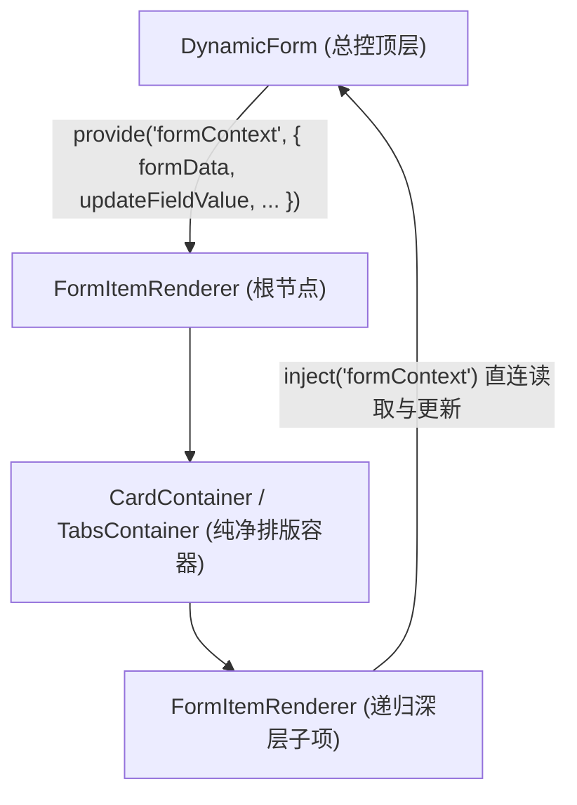

# 动态表单设计器与渲染器架构设计指南与演进路线

> **文档定位**: 本文档记录了表单设计器与渲染器的工业级架构重构历程、设计模式、标准物料模型、统一插槽协议（Slot Model）、联动计算引擎规范，以及后续阶段的开发实施路线图（方便跨设备、无缝接续高效开发）。

---

## 一、 系统架构总览与核心设计模式

整个表单引擎遵循大厂（阿里 Formily / 百度 AMIS / 阿里 LowCode Engine）工业级低代码设计规范，严格解耦为：**物料注册中心**、**纯净排版容器**、**自闭环基础字段**、**设计态画布**、**运行态渲染器**、**公式计算引擎**：

```text
src/pages/formDesign/
├── widgets/                             # 🌟 1. 物料注册中心 (Widget Registry)
│   ├── index.js                         # 物料注册表统一入口 (导出 fieldWidgets, containerWidgets, getWidget, getContainerComponent, getFieldComponent, traverseWidgets, cloneWidgetWithNewIds)
│   ├── containers/                      # 纯净布局容器排版物料 (仅负责外观与具名插槽分发，零拖拽/零表单提交耦合)
│   │   ├── GridContainer.vue            # 栅格布局外壳 (el-row / el-col，插槽: col_0, col_1...)
│   │   ├── CardContainer.vue            # 分组卡片外壳 (el-card，插槽: default)
│   │   └── TabsContainer.vue            # 标签页外壳 (el-tabs / el-tab-pane，插槽: tab_1, tab_2...)
│   └── settings/                        # 各组件专属属性面板 Setter (高内聚、自包含)
│       ├── InputSetting.vue             # 文本类配置 (字数、计数、清除、预设正则校验规则)
│       ├── NumberSetting.vue            # 数字类配置 (最小值、最大值、步长、精度、加减按钮)
│       ├── SelectSetting.vue            # 选择/单选/多选配置 (静态选项列表、动态 API 接口、默认当前人)
│       ├── DatePickerSetting.vue        # 日期类配置 (展示格式 format、绑定格式 valueFormat)
│       ├── SwitchSetting.vue            # 开关类配置 (开启/关闭提示文字)
│       ├── UploadSetting.vue            # 附件类配置 (文件后缀白名单、张数、文件限额、提示文案)
│       ├── GridSetting.vue              # 栅格类配置 (分栏间隔 gutter、列数、24 栅格比例滑块)
│       ├── CardSetting.vue              # 卡片类配置 (卡片标题 title、阴影风格 shadow、边框显隐 bordered)
│       └── TabsSetting.vue              # 标签页配置 (风格 tabType、位置 tabPosition、Tab 分页增删改)
│
├── components/                          # 🌟 2. 运行态渲染器 (业务页面 / 工作流 / 审批抽屉直接复用)
│   ├── DynamicForm.vue                  # 表单总控容器 (校验引擎、响应式数据同步、全局公式计算、API 加载)
│   ├── FormItemRenderer.vue             # 递归表单项解析器 (核心：双统一动态驱动，彻底消灭所有容器与字段 v-if/else-if)
│   └── widgets/                         # 基础自闭环字段物料 Renderer (自包含子标签循环，与 FileUploadWidget 统一标准)
│       ├── FileUploadWidget.vue         # 自包含的发票/附件卡片列表组件 (防闪烁、PDF专属徽标、真机/设计双模)
│       ├── SelectWidget.vue             # 自闭环下拉选择器 (内聚 el-select + el-option，支持动态数据源)
│       ├── RadioWidget.vue              # 自闭环单选框组 (内聚 el-radio-group + el-radio)
│       └── CheckboxWidget.vue           # 自闭环多选框组 (内聚 el-checkbox-group + el-checkbox，数组模型保障)
│
├── designer/                            # 🌟 3. 设计态工作区
│   ├── DesignItemRenderer.vue           # 画布递归设计项 (严格单根原生 DOM、统一容器槽位拖拽、字段动态渲染、复制/删除)
│   └── ComputedFieldSetting.vue         # 双模式计算字段面板 (简易向导点选 + 排他网关同款字段胶囊)
│
├── utils/
│   └── formula.js                       # 🌟 4. 内置安全公式函数库 (DATEDIF, SUM, MULTIPLY, IF, ROUND)
│
└── formDesign.vue                       # 🌟 5. 设计器总入口 (左侧物料库 + 中间画布 + 右侧属性栏 + 真机全屏实时仿真预览)
```

---

## 二、 核心重构里程碑与工业级设计规范

### 1. 统一插槽协议（Unified Slot Model）—— 彻底消除兼容性代码
为解决此前容器子节点存储各异（Grid 用 `columns[].list`、Card 用 `list`、Tabs 用 `panes[].list`）带来的分支判断地狱，确立**全引擎统一的数据结构契约**：

```json
// 任何容器节点，一律标准收敛为：
{
  "id": "card_1728552000000_a3x",
  "type": "card", // 或 grid, tabs, collapse, steps
  "props": { ...组件专属展示属性 },
  "slots": {
    "default": [ ...子组件A, 子组件B ],
    "col_0": [ ... ],
    "tab_1": [ ... ]
  }
}
```

* **通用树形深搜遍历器 (`traverseWidgets`)**：10 行通用代码穿透所有已知和未来容器，**零 if/else 判断**；
* **一键克隆与高熵 ID 重置 (`cloneWidgetWithNewIds`)**：递归重置容器与所有层级子物料 ID，**零 if/else 判断**；
* **容器子项增删与复制**：统一操作 `{ parent, slotKey, index }`，**1 行代码通用处理所有容器**。

---

### 2. 动静分离与双端“零 `v-if/else-if`”引擎（开闭原则 OCP 落地）

#### ① 容器层解耦：
* 提取独立纯净排版组件 [`widgets/containers/`](file:///e:/nest/mynest1/vue-vite/vue-vite/src/pages/formDesign/widgets/containers/)；
* 设计态根据 `element.slots` 自动挂载 `<draggable>` 区域；
* 运行态根据 `item.slots` 自动递归调用子项渲染；
* **画布设计器与运行态解析器中，针对容器的几十行 `v-if/else-if` 全部消除为单一动态挂载：**
  ```html
  <component :is="getContainerComponent(item.type)" :props-data="item.props">
      <template v-for="(slotList, slotKey) in item.slots" :key="slotKey" #[slotKey]>
          ...
      </template>
  </component>
  ```

#### ② 基础字段层自闭环（第一阶段已彻底落地）：
* 将包含子选项循环的 `select`、`radio`、`checkbox` 以及复合逻辑的 `upload` 全部沉淀为独立的自闭环物料；
* [`FormItemRenderer.vue`](file:///e:/nest/mynest1/vue-vite/vue-vite/src/pages/formDesign/components/FormItemRenderer.vue) 与 [`DesignItemRenderer.vue`](file:///e:/nest/mynest1/vue-vite/vue-vite/src/pages/formDesign/designer/DesignItemRenderer.vue) 中的字段分支**全部消除为单一动态组件挂载：**
  ```html
  <component :is="getFieldComponent(item.type)" ... />
  ```
* **将来扩展新字段（如级联 Cascader、评分 Rate、滑块 Slider、富文本）时，主渲染器与画布代码 0 修改、0 侵入！**

---

### 3. 一键复制物料与真机全屏实时预览仿真
* **一键复制**：支持顶级字段、顶级容器、容器内嵌套子字段的快捷深度克隆，自动重置全新高熵唯一 ID；
* **真机全屏实时仿真预览 (`Live Simulation Modal`)**：
  * 画布顶部集成【真机全屏预览】；
  * 弹窗内挂载真实业务填单容器 `DynamicForm.vue`；
  * 提供双 Tab 交互：**表单交互渲染测试** 与 **实时响应式数据 JSON View**；
  * 支持直接在预览弹窗中执行规则校验（Validate）与清空重置（Reset）。

---

### 4. 表单上下文（Form Context）数据流解耦（第二阶段已彻底落地）
为解决此前深层容器嵌套递归时 Props 逐层透传（Props Drilling）与跨层 `$emit` 事件冒泡的工程痛点，引入 Vue 3 依赖注入（`provide / inject`）模式：



* **消灭空转透传**：深层嵌套容器（`Tabs -> Card -> Grid -> Input`）彻底纯净化，无需在模板上层层声明 `:model-value`、`:options-map`、`:loading-map`、`:no-approval`，也无需逐级转发 `@update:model-value`；
* **Vue 3 官方 `unref` 安全响应式解析**：在子孙节点消费上下文时，使用 `unref(formContext.disabled)` 与 `unref(formContext.noApproval)` 精准解包，杜绝了 JS 中 `false || RefObject` 判定为 Truthy 对象的经典隐蔽 Bug；
* **天然支持就近遮蔽（Shadowing）**：主表单广播全局数据流；未来进入第三阶段实现“子表单（明细行表格）”时，每行可局部覆盖 `provide('formContext', rowContext)`，天然隔离主表单与子行数据，零变量污染。

---

## 三、 物料分类矩阵与双生模型（Twin Model）

每个物料在设计体系中由**“呈现态 (Renderer)”**与**“属性配置态 (Setter)”**构成：

| 分类 | 物料类型 | 组件标识 | 呈现态 Renderer (如何显示) | 配置态 Setter (右侧面板) | 核心特性 / 插槽 |
| :--- | :--- | :--- | :--- | :--- | :--- |
| **容器** | **栅格布局** | `grid` | `GridContainer.vue` | `GridSetting.vue` | 多列比例滑块 (24栅格)，插槽: `col_0`, `col_1`... |
| **容器** | **分组卡片** | `card` | `CardContainer.vue` | `CardSetting.vue` | 标题、边框、阴影切换，插槽: `default` |
| **容器** | **标签页** | `tabs` | `TabsContainer.vue` | `TabsSetting.vue` | 常规/卡片/边框卡片，分页管理，插槽: `tab_1`, `tab_2`... |
| **字段** | **单行文本** | `input` | 原生 `el-input` | `InputSetting.vue` | 正则预设校验 (手机/邮箱/身份证/数字) |
| **字段** | **多行文本** | `textarea` | 原生 `el-input` | `InputSetting.vue` | 行数设置、字数限制与统计 |
| **字段** | **数字输入** | `number` | 原生 `el-input-number` | `NumberSetting.vue` | 纯数值模型，精度、步长、极值控制 |
| **字段** | **下拉选择** | `select` | `SelectWidget.vue` | `SelectSetting.vue` | 自闭环，静态选项管理与远程 API 加载 |
| **字段** | **单选框组** | `radio` | `RadioWidget.vue` | `SelectSetting.vue` | 自闭环选项平铺展示 |
| **字段** | **多选框组** | `checkbox` | `CheckboxWidget.vue` | `SelectSetting.vue` | 自闭环安全数组双向绑定 |
| **字段** | **开关** | `switch` | 原生 `el-switch` | `SwitchSetting.vue` | 开启/关闭提示文本配置 |
| **字段** | **日期选择** | `date-picker` | 原生 `el-date-picker` | `DatePickerSetting.vue`| 展示与存储格式解耦 (`YYYY-MM-DD`) |
| **字段** | **级联选择** | `cascader` | 原生 `el-cascader` | `CascaderSetting.vue` | 树形层级数据、任意一级可选、省市区/组织架构预设、动态树 API |
| **字段** | **滑块** | `slider` | 原生 `el-slider` | `SliderSetting.vue` | 最小值、最大值、步长、右侧数值输入框、间断点 |
| **字段** | **发票/附件** | `upload` | `FileUploadWidget.vue` | `UploadSetting.vue` | 防闪烁发票卡片、PDF 徽标、文件限额白名单 |

---

## 四、 物料封装设计哲学：单标签 vs 复合标签

在低代码引擎的物料体系中，**并不是“每加一个组件就要新建一个 `.vue` 文件”**。遵循软件工程的奥卡姆剃刀原则（如无必要，勿增实体），物料呈现层划分为三种形态：

### 1. 自闭环单标签组件（原生 0 文件接入，占 80%）
* **特征**：组件本身是一个单独的标签，原生支持 `v-model`（即 `:model-value` + `@update:model-value`），不需要任何内嵌子标签或循环插槽。
* **代表组件**：
  * 级联选择器 (`el-cascader`)：原生通过 `:options` 接收层级树形数组，弹层逻辑由组件自闭环完成；
  * 评分 (`el-rate`)、滑块 (`el-slider`)、颜色选择器 (`el-color-picker`)；
  * 开关 (`el-switch`)、计数器 (`el-input-number`)、时间选择器 (`el-time-picker`)。
* **为什么不需要建 `.vue` 文件？**
  `FormItemRenderer` 和 `DesignItemRenderer` 已经通过统一的 `<component :is="getFieldComponent(item.type)" />` 实现了动态组件挂载。为这些原生标签多写一层 `.vue` 包装，除了制造文件碎片和无谓的运行时开销外，毫无工程价值。

### 2. 非闭环复合标签组件（必须封装自闭环微物料 SFC，占 15%）
* **特征**：Element Plus 的父级组件只提供容器，**必须在模板内嵌套循环特定的子组件标签**才能完整显示。
* **代表组件**：
  * 下拉框：`<el-select>` 必须内嵌 `<el-option v-for="opt in options">`；
  * 单选框组：`<el-radio-group>` 必须内嵌 `<el-radio v-for="opt in options">`；
  * 多选框组：`<el-checkbox-group>` 必须内嵌 `<el-checkbox v-for="opt in options">`。
* **为什么必须新建独立 `.vue` 物料（如 `SelectWidget.vue`）？**
  如果直接在通用挂载器写 `<component :is="'el-radio-group'" />`，因为缺少内部子标签的渲染循环，页面上呈现出来的就是一个空盒子！封装自闭环微物料的职责就是：**“将子标签的循环逻辑内聚在组件内部，对外暴露符合标准的单一 `modelValue` 与 `options` 输入输出协议”**。

### 3. 深度定制的业务物料（必须建独立 `.vue` 物料，占 5%）
* **代表组件**：
  * 发票/附件物料 ([`FileUploadWidget.vue`](file:///e:/nest/mynest1/vue-vite/vue-vite/src/pages/formDesign/components/widgets/FileUploadWidget.vue))：原生 `el-upload` 过于简陋，业务上需要发票卡片展示、PDF 徽标、缩略图错误兜底、真机/设计双模态等复杂交互；
  * 子表单表格物料 (`SubformWidget.vue`)：动态增删表格明细行、多列子表单校验、公式列合计。

---

## 五、 物料扩展实战指南（Developer Guide）

### 场景 A：如何新增【自闭环单标签 Element 组件】（以级联 Cascader / 评分 Rate 为例）
> **开发成本**：**0 行 Vue 渲染器代码，仅需 2 步**！

#### 第 1 步：在 `widgets/settings/` 编写属性设置器
例如新建 `CascaderSetting.vue`（或者复用 `SelectSetting.vue` 配置静态 options / 动态 API），支持配置 `placeholder`、`disabled`、`clearable` 等。

#### 第 2 步：在 [`widgets/index.js`](file:///e:/nest/mynest1/vue-vite/vue-vite/src/pages/formDesign/widgets/index.js) 中声明并注册
```javascript
{
    type: 'cascader',
    label: '级联选择',
    icon: 'Connection',
    category: 'basic',
    isContainer: false,
    component: 'el-cascader',                    // 🌟 直接指定原生标签名，0 新建渲染文件！
    settingComponent: markRaw(CascaderSetting),  // 右侧属性面板
    createDefault: () => ({
        id: generateWidgetId('cascader'),
        type: 'cascader',
        component: 'el-cascader',
        props: {
            label: '级联选择',
            placeholder: '请选择所在地区/部门',
            required: false,
            disabled: false,
            clearable: true,
            options: [
                { value: 'zhejiang', label: '浙江省', children: [{ value: 'hangzhou', label: '杭州市' }] }
            ],
        },
    }),
}
```
**完成！画布与运行态 `FormItemRenderer` 自动识别并渲染出完美的级联选择器！**

---

### 场景 B：如何新增【非闭环/复合标签组件】（以按钮样式单选 RadioButton 为例）
> **开发成本**：**3 步，新建 1 个自闭环微物料**。

#### 第 1 步：在 `components/widgets/` 新建自闭环物料（如 `RadioButtonWidget.vue`）
```html
<template>
    <el-radio-group
        :model-value="modelValue"
        :disabled="disabled"
        @update:model-value="val => $emit('update:modelValue', val)"
    >
        <el-radio-button
            v-for="opt in options"
            :key="opt.value"
            :value="opt.value"
            :label="opt.value"
        >
            {{ opt.label }}
        </el-radio-button>
    </el-radio-group>
</template>

<script setup>
defineProps({
    modelValue: { type: [String, Number, Boolean], default: '' },
    options: { type: Array, default: () => [] },
    disabled: { type: Boolean, default: false },
});
defineEmits(['update:modelValue']);
</script>
```

#### 第 2 步：在 `widgets/settings/` 关联属性面板（可直接复用 `SelectSetting.vue`）

#### 第 3 步：在 [`widgets/index.js`](file:///e:/nest/mynest1/vue-vite/vue-vite/src/pages/formDesign/widgets/index.js) 中导入并注册
```javascript
import RadioButtonWidget from '../components/widgets/RadioButtonWidget.vue';

// 注册
{
    type: 'radio-button',
    label: '按钮单选',
    icon: 'SetUp',
    component: markRaw(RadioButtonWidget), // 🌟 挂载自闭环微物料
    settingComponent: markRaw(SelectSetting),
    ...
}
```

---

### 场景 C：如何新增【排版容器】（以折叠面板 Collapse 为例）
> **开发成本**：**完全遵循统一插槽协议，3 步即可**。

1. **新建容器组件**：在 `widgets/containers/CollapseContainer.vue` 中编写排版组件，定义 `<el-collapse>`，根据 `slots` 插槽遍历具名插槽：
   ```html
   <el-collapse v-model="activeNames">
       <el-collapse-item v-for="(slotList, slotKey) in slots" :name="slotKey" :title="getTitle(slotKey)">
           <slot :name="slotKey" />
       </el-collapse-item>
   </el-collapse>
   ```
2. **新建属性面板**：在 `widgets/settings/CollapseSetting.vue` 中配置面板折叠项名称增删；
3. **注册容器**：在 `widgets/index.js` 的 `containerWidgets` 中注册，声明 `isContainer: true` 与 `slots: { panel_1: [], panel_2: [] }`。

---

### 场景 D：如何新增【第三方复杂微物料】（以富文本编辑器 RichText 为例）
> **开发定位**：富文本 100% 属于**普通数据录入字段**（输出标准 HTML 字符串 `formData[id] = '<p>...</p>'`），核心渲染引擎 0 改动！

#### 1. 大厂工程实践防坑要点
* **防画布拖拽崩溃（双模设计）**：
  * **设计态 (`isDesign: true`)**：渲染轻量骨架仿真占位卡片，杜绝在 `vuedraggable` 排序时频繁触发富文本编辑沙盒初始化导致的卡顿、光标夺焦与报错；
  * **运行态 (`isDesign: false`)**：挂载真实的编辑器引擎（如 `@wangeditor/editor-for-vue`），提供完整的图文编辑排版能力。
* **防图片 Base64 膨胀打崩接口**：拦截编辑器内部的粘图/插图事件，统一调用 `/upload/uploadFile` 接口上传后仅插入图片 URL。
* **防内存泄漏**：在组件 `onBeforeUnmount` 生命周期中显式调用 `editor.destroy()`。

#### 2. 三步实施步骤
1. **新建自闭环微物料**：`components/widgets/RichTextWidget.vue`（处理双模态展示、图片接口上传、销毁释放）；
2. **新建属性面板**：`widgets/settings/RichTextSetting.vue`（配置编辑器容器高度 `height`、占位提示 `placeholder`）；
3. **物料注册中心登记**：在 `widgets/index.js` 中引入并追加 `type: 'richtext'` 物料定义。

---

## 六、 后续演进阶段路线图（Roadmap）

### ✅ 今日成果总览（已彻底落地验收）
* **纯净排版容器协议统一**：完成 Grid / Card / Tabs 统一 `slots` 协议与深搜递归，消灭数十处容器分支；
* **表单上下文（Form Context）解耦**：落地 `provide / inject` 直连数据流，消灭 4 层 Props Drilling 空转，使用 `unref` 消除布尔对象 Truthy 隐患；
* **单标签组件零侵入接入验证**：成功极速接入 **级联选择器 (`cascader`)** 与 **滑块 (`slider`)**；
* **样式架构彻底净化**：将行内 style 特判收敛至 CSS 深度选择器，并使用 `:not(.el-slider__input)` 精准防护避免内置组件误伤。

### 🚀 明日接续开发规划（按优先级）

#### 任务 1：核心业务容器 —— 子表单明细表格 (`subform`)
* **业务场景**：报销费用清单、采购品明细等动态多行录入；
* **核心目标**：
  * 行内支持动态增行、删行、行上下拖拽排序；
  * 支持行内字段公式计算，底部自动聚合计算列总计金额；
  * 标准化数据模型：`formData[subformId] = [{ feeType: '', amount: 0 }]`；
  * 利用 Vue 3 依赖注入的就近遮蔽（Context Shadowing）机制，为每行局部注入 `rowContext`。

#### 任务 2：富文本编辑器物料接入 (`richtext`)
* 安装 `@wangeditor/editor` 与 `@wangeditor/editor-for-vue`；
* 落地双模态自闭环微物料 `RichTextWidget.vue` 与配置面板 `RichTextSetting.vue`。

#### 任务 3：交互高级体验（Undo/Redo & 移动端仿真壳）
* 快照历史栈 `useHistory`（`Ctrl+Z` / `Ctrl+Y` 撤销重做）；
* 真机全屏预览弹窗支持【💻 PC 桌面端】与【📱 移动端 iPhone 375px 仿真壳】无缝切换。


