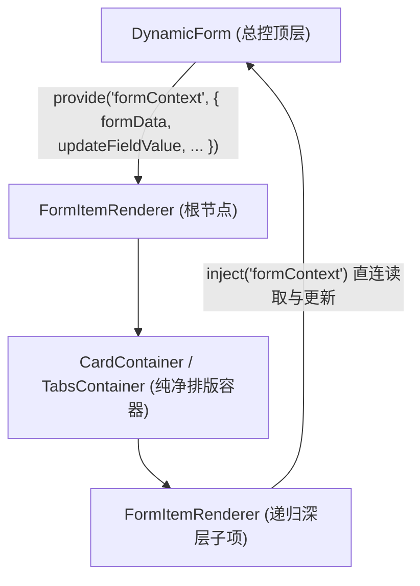

# 动态表单设计器与渲染器架构设计指南与演进路线

> **文档定位**: 本文档记录了表单设计器与渲染器的工业级架构重构历程、设计模式、标准物料模型、统一插槽协议（Slot Model）、联动计算引擎规范，以及后续阶段的开发实施路线图（方便跨设备、无缝接续高效开发）。

---

## 一、 系统架构总览与核心设计模式

整个表单引擎遵循大厂（阿里 Formily / 百度 AMIS / 阿里 LowCode Engine）工业级低代码设计规范，严格解耦为：**物料注册中心**、**纯净排版容器**、**自闭环基础字段**、**设计态画布**、**运行态渲染器**、**公式计算引擎**：

```text
src/pages/formDesign/
├── widgets/                             # 🌟 1. 物料注册中心 (Widget Registry)
│   ├── index.js                         # 物料注册表统一入口 (导出 fieldWidgets, containerWidgets, getWidget, getContainerComponent, getFieldComponent, traverseWidgets, cloneWidgetWithNewIds)
│   ├── containers/                      # 纯净布局容器排版物料 (仅负责外观与具名插槽分发，零拖拽/零表单提交耦合)
│   │   ├── GridContainer.vue            # 栅格布局外壳 (el-row / el-col，插槽: col_0, col_1...)
│   │   ├── CardContainer.vue            # 分组卡片外壳 (el-card，插槽: default)
│   │   ├── TabsContainer.vue            # 标签页外壳 (el-tabs / el-tab-pane，插槽: tab_1, tab_2...)
│   │   └── SubformContainer.vue         # 子表单容器外壳 (slots: default，支持自由拖入栅格与字段，仿真 [+ -] 控制栏)
│   └── settings/                        # 各组件专属属性面板 Setter (高内聚、自包含)
│       ├── InputSetting.vue             # 文本类配置 (字数、计数、清除、预设正则校验规则)
│       ├── NumberSetting.vue            # 数字类配置 (最小值、最大值、步长、精度、加减按钮)
│       ├── SelectSetting.vue            # 选择/单选/多选配置 (静态选项列表、动态 API 接口、默认当前人)
│       ├── CascaderSetting.vue          # 级联选择配置 (内置省市区/部门预设、JSON 树弹窗校验编辑、任意级可选、多选)
│       ├── SliderSetting.vue            # 滑块配置 (极值 min/max、步长 step、显示输入框、间断点)
│       ├── SubformSetting.vue           # 子表单配置 (展示形态: 卡片子表单 vs 表格表单、增行按钮文案、自动合计、行数限制)
│       ├── DatePickerSetting.vue        # 日期类配置 (展示格式 format、绑定格式 valueFormat)
│       ├── SwitchSetting.vue            # 开关类配置 (开启/关闭提示文字)
│       ├── UploadSetting.vue            # 附件类配置 (文件后缀白名单、张数、文件限额、提示文案)
│       ├── GridSetting.vue              # 栅格类配置 (分栏间隔 gutter、列数、24 栅格比例滑块)
│       ├── CardSetting.vue              # 卡片类配置 (卡片标题 title、阴影风格 shadow、边框显隐 bordered)
│       └── TabsSetting.vue              # 标签页配置 (风格 tabType、位置 tabPosition、Tab 分页增删改)
│
├── components/                          # 🌟 2. 运行态渲染器 (业务页面 / 工作流 / 审批抽屉直接复用)
│   ├── DynamicForm.vue                  # 表单总控容器 (校验引擎、响应式数据同步、全局公式计算、API 加载)
│   ├── FormItemRenderer.vue             # 递归表单项解析器 (核心：双统一动态驱动，彻底消灭所有容器与字段 v-if/else-if)
│   └── widgets/                         # 基础自闭环字段与业务容器物料 Renderer
│       ├── FileUploadWidget.vue         # 自包含的发票/附件卡片列表组件 (防闪烁、PDF专属徽标、真机/设计双模)
│       ├── SelectWidget.vue             # 自闭环下拉选择器 (内聚 el-select + el-option，支持动态数据源)
│       ├── RadioWidget.vue              # 自闭环单选框组 (内聚 el-radio-group + el-radio)
│       ├── CheckboxWidget.vue           # 自闭环多选框组 (内聚 el-checkbox-group + el-checkbox，数组模型保障)
│       ├── SubformWidget.vue            # 子表单业务物料总控 (卡片模式 + 紧凑表格模式双模驱动，二维数组聚合，自动合计)
│       └── SubformRowItem.vue           # 子表单卡片动态行单元 (就近遮蔽 Context Shadowing，全模板递归渲染，支持栅格内嵌)
│
├── designer/                            # 🌟 3. 设计态工作区
│   ├── DesignItemRenderer.vue           # 画布递归设计项 (严格单根原生 DOM、统一容器槽位拖拽、字段动态渲染、复制/删除)
│   └── ComputedFieldSetting.vue         # 双模式计算字段面板 (简易向导点选 + 排他网关同款字段胶囊)
│
├── utils/
│   └── formula.js                       # 🌟 4. 内置安全公式函数库 (DATEDIF, SUM, MULTIPLY, IF, ROUND)
│
└── formDesign.vue                       # 🌟 5. 设计器总入口 (左侧物料库 + 中间画布 + 右侧属性栏 + 真机全屏实时仿真预览)
```

---

## 二、 核心重构里程碑与工业级设计规范

### 1. 统一插槽协议（Unified Slot Model）—— 彻底消除兼容性代码
为解决此前容器子节点存储各异（Grid 用 `columns[].list`、Card 用 `list`、Tabs 用 `panes[].list`）带来的分支判断地狱，确立**全引擎统一的数据结构契约**：

```json
// 任何容器节点，一律标准收敛为：
{
  "id": "card_1728552000000_a3x",
  "type": "card", // 或 grid, tabs, collapse, steps
  "props": { ...组件专属展示属性 },
  "slots": {
    "default": [ ...子组件A, 子组件B ],
    "col_0": [ ... ],
    "tab_1": [ ... ]
  }
}
```

* **通用树形深搜遍历器 (`traverseWidgets`)**：10 行通用代码穿透所有已知和未来容器，**零 if/else 判断**；
* **一键克隆与高熵 ID 重置 (`cloneWidgetWithNewIds`)**：递归重置容器与所有层级子物料 ID，**零 if/else 判断**；
* **容器子项增删与复制**：统一操作 `{ parent, slotKey, index }`，**1 行代码通用处理所有容器**。

---

### 2. 动静分离与双端“零 `v-if/else-if`”引擎（开闭原则 OCP 落地）

#### ① 容器层解耦：
* 提取独立纯净排版组件 [`widgets/containers/`](file:///e:/nest/mynest1/vue-vite/vue-vite/src/pages/formDesign/widgets/containers/)；
* 设计态根据 `element.slots` 自动挂载 `<draggable>` 区域；
* 运行态根据 `item.slots` 自动递归调用子项渲染；
* **画布设计器与运行态解析器中，针对容器的几十行 `v-if/else-if` 全部消除为单一动态挂载：**
  ```html
  <component :is="getContainerComponent(item.type)" :props-data="item.props">
      <template v-for="(slotList, slotKey) in item.slots" :key="slotKey" #[slotKey]>
          ...
      </template>
  </component>
  ```

#### ② 基础字段层自闭环（第一阶段已彻底落地）：
* 将包含子选项循环的 `select`、`radio`、`checkbox` 以及复合逻辑的 `upload` 全部沉淀为独立的自闭环物料；
* [`FormItemRenderer.vue`](file:///e:/nest/mynest1/vue-vite/vue-vite/src/pages/formDesign/components/FormItemRenderer.vue) 与 [`DesignItemRenderer.vue`](file:///e:/nest/mynest1/vue-vite/vue-vite/src/pages/formDesign/designer/DesignItemRenderer.vue) 中的字段分支**全部消除为单一动态组件挂载：**
  ```html
  <component :is="getFieldComponent(item.type)" ... />
  ```
* **将来扩展新字段（如级联 Cascader、评分 Rate、滑块 Slider、富文本）时，主渲染器与画布代码 0 修改、0 侵入！**

---

### 3. 一键复制物料与真机全屏实时预览仿真
* **一键复制**：支持顶级字段、顶级容器、容器内嵌套子字段的快捷深度克隆，自动重置全新高熵唯一 ID；
* **真机全屏实时仿真预览 (`Live Simulation Modal`)**：
  * 画布顶部集成【真机全屏预览】；
  * 弹窗内挂载真实业务填单容器 `DynamicForm.vue`；
  * 提供双 Tab 交互：**表单交互渲染测试** 与 **实时响应式数据 JSON View**；
  * 支持直接在预览弹窗中执行规则校验（Validate）与清空重置（Reset）。

---

### 4. 表单上下文（Form Context）数据流解耦（第二阶段已彻底落地）
为解决此前深层容器嵌套递归时 Props 逐层透传（Props Drilling）与跨层 `$emit` 事件冒泡的工程痛点，引入 Vue 3 依赖注入（`provide / inject`）模式：



* **消灭空转透传**：深层嵌套容器（`Tabs -> Card -> Grid -> Input`）彻底纯净化，无需在模板上层层声明 `:model-value`、`:options-map`、`:loading-map`、`:no-approval`，也无需逐级转发 `@update:model-value`；
* **Vue 3 官方 `unref` 安全响应式解析**：在子孙节点消费上下文时，使用 `unref(formContext.disabled)` 与 `unref(formContext.noApproval)` 精准解包，杜绝了 JS 中 `false || RefObject` 判定为 Truthy 对象的经典隐蔽 Bug；
* **天然支持就近遮蔽（Shadowing）**：主表单广播全局数据流；未来进入第三阶段实现“子表单（明细行表格）”时，每行可局部覆盖 `provide('formContext', rowContext)`，天然隔离主表单与子行数据，零变量污染。

---

## 三、 物料分类矩阵与双生模型（Twin Model）

每个物料在设计体系中由**“呈现态 (Renderer)”**与**“属性配置态 (Setter)”**构成：

| 分类 | 物料类型 | 组件标识 | 呈现态 Renderer (如何显示) | 配置态 Setter (右侧面板) | 核心特性 / 插槽 |
| :--- | :--- | :--- | :--- | :--- | :--- |
| **容器** | **栅格布局** | `grid` | `GridContainer.vue` | `GridSetting.vue` | 多列比例滑块 (24栅格)，插槽: `col_0`, `col_1`... |
| **容器** | **分组卡片** | `card` | `CardContainer.vue` | `CardSetting.vue` | 标题、边框、阴影切换，插槽: `default` |
| **容器** | **标签页** | `tabs` | `TabsContainer.vue` | `TabsSetting.vue` | 常规/卡片/边框卡片，分页管理，插槽: `tab_1`, `tab_2`... |
| **容器** | **子表单** | `subform` | `SubformContainer.vue` (设计态) / `SubformWidget.vue` + `SubformRowItem.vue` (运行态) | `SubformSetting.vue` | 动态块级表单组 (默认卡片模式支持栅格/多列) + 紧凑表格模式双模驱动，插槽: `default` |
| **字段** | **单行文本** | `input` | 原生 `el-input` | `InputSetting.vue` | 正则预设校验 (手机/邮箱/身份证/数字) |
| **字段** | **多行文本** | `textarea` | 原生 `el-input` | `InputSetting.vue` | 行数设置、字数限制与统计 |
| **字段** | **数字输入** | `number` | 原生 `el-input-number` | `NumberSetting.vue` | 纯数值模型，精度、步长、极值控制 |
| **字段** | **下拉选择** | `select` | `SelectWidget.vue` | `SelectSetting.vue` | 自闭环，静态选项管理与远程 API 加载 |
| **字段** | **单选框组** | `radio` | `RadioWidget.vue` | `SelectSetting.vue` | 自闭环选项平铺展示 |
| **字段** | **多选框组** | `checkbox` | `CheckboxWidget.vue` | `SelectSetting.vue` | 自闭环安全数组双向绑定 |
| **字段** | **开关** | `switch` | 原生 `el-switch` | `SwitchSetting.vue` | 开启/关闭提示文本配置 |
| **字段** | **日期选择** | `date-picker` | 原生 `el-date-picker` | `DatePickerSetting.vue`| 展示与存储格式解耦 (`YYYY-MM-DD`) |
| **字段** | **级联选择** | `cascader` | 原生 `el-cascader` | `CascaderSetting.vue` | 树形层级数据、任意一级可选、省市区/组织架构预设、动态树 API |
| **字段** | **滑块** | `slider` | 原生 `el-slider` | `SliderSetting.vue` | 最小值、最大值、步长、右侧数值输入框、间断点 |
| **字段** | **发票/附件** | `upload` | `FileUploadWidget.vue` | `UploadSetting.vue` | 防闪烁发票卡片、PDF 徽标、文件限额白名单 |
| **字段** | **富文本** | `richtext` | `RichTextWidget.vue` | `RichTextSetting.vue` | 双模态骨架防拖拽死锁，WangEditor v5 完整图文排版与图片上传拦截 |

---

## 四、 物料封装设计哲学：单标签 vs 复合标签

在低代码引擎的物料体系中，**并不是“每加一个组件就要新建一个 `.vue` 文件”**。遵循软件工程的奥卡姆剃刀原则（如无必要，勿增实体），物料呈现层划分为三种形态：

### 1. 自闭环单标签组件（原生 0 文件接入，占 80%）
* **特征**：组件本身是一个单独的标签，原生支持 `v-model`（即 `:model-value` + `@update:model-value`），不需要任何内嵌子标签或循环插槽。
* **代表组件**：
  * 级联选择器 (`el-cascader`)：原生通过 `:options` 接收层级树形数组，弹层逻辑由组件自闭环完成；
  * 评分 (`el-rate`)、滑块 (`el-slider`)、颜色选择器 (`el-color-picker`)；
  * 开关 (`el-switch`)、计数器 (`el-input-number`)、时间选择器 (`el-time-picker`)。
* **为什么不需要建 `.vue` 文件？**
  `FormItemRenderer` 和 `DesignItemRenderer` 已经通过统一的 `<component :is="getFieldComponent(item.type)" />` 实现了动态组件挂载。为这些原生标签多写一层 `.vue` 包装，除了制造文件碎片和无谓的运行时开销外，毫无工程价值。

### 2. 非闭环复合标签组件（必须封装自闭环微物料 SFC，占 15%）
* **特征**：Element Plus 的父级组件只提供容器，**必须在模板内嵌套循环特定的子组件标签**才能完整显示。
* **代表组件**：
  * 下拉框：`<el-select>` 必须内嵌 `<el-option v-for="opt in options">`；
  * 单选框组：`<el-radio-group>` 必须内嵌 `<el-radio v-for="opt in options">`；
  * 多选框组：`<el-checkbox-group>` 必须内嵌 `<el-checkbox v-for="opt in options">`。
* **为什么必须新建独立 `.vue` 物料（如 `SelectWidget.vue`）？**
  如果直接在通用挂载器写 `<component :is="'el-radio-group'" />`，因为缺少内部子标签的渲染循环，页面上呈现出来的就是一个空盒子！封装自闭环微物料的职责就是：**“将子标签的循环逻辑内聚在组件内部，对外暴露符合标准的单一 `modelValue` 与 `options` 输入输出协议”**。

### 3. 深度定制的业务物料（必须建独立 `.vue` 物料，占 5%）
* **代表组件**：
  * 发票/附件物料 ([`FileUploadWidget.vue`](file:///e:/nest/mynest1/vue-vite/vue-vite/src/pages/formDesign/components/widgets/FileUploadWidget.vue))：原生 `el-upload` 过于简陋，业务上需要发票卡片展示、PDF 徽标、缩略图错误兜底、真机/设计双模态等复杂交互；
  * 子表单表格物料 (`SubformWidget.vue`)：动态增删表格明细行、多列子表单校验、公式列合计。

---

## 五、 物料扩展实战指南（Developer Guide）

### 场景 A：如何新增【自闭环单标签 Element 组件】（以级联 Cascader / 评分 Rate 为例）
> **开发成本**：**0 行 Vue 渲染器代码，仅需 2 步**！

#### 第 1 步：在 `widgets/settings/` 编写属性设置器
例如新建 `CascaderSetting.vue`（或者复用 `SelectSetting.vue` 配置静态 options / 动态 API），支持配置 `placeholder`、`disabled`、`clearable` 等。

#### 第 2 步：在 [`widgets/index.js`](file:///e:/nest/mynest1/vue-vite/vue-vite/src/pages/formDesign/widgets/index.js) 中声明并注册
```javascript
{
    type: 'cascader',
    label: '级联选择',
    icon: 'Connection',
    category: 'basic',
    isContainer: false,
    component: 'el-cascader',                    // 🌟 直接指定原生标签名，0 新建渲染文件！
    settingComponent: markRaw(CascaderSetting),  // 右侧属性面板
    createDefault: () => ({
        id: generateWidgetId('cascader'),
        type: 'cascader',
        component: 'el-cascader',
        props: {
            label: '级联选择',
            placeholder: '请选择所在地区/部门',
            required: false,
            disabled: false,
            clearable: true,
            options: [
                { value: 'zhejiang', label: '浙江省', children: [{ value: 'hangzhou', label: '杭州市' }] }
            ],
        },
    }),
}
```
**完成！画布与运行态 `FormItemRenderer` 自动识别并渲染出完美的级联选择器！**

---

### 场景 B：如何新增【非闭环/复合标签组件】（以按钮样式单选 RadioButton 为例）
> **开发成本**：**3 步，新建 1 个自闭环微物料**。

#### 第 1 步：在 `components/widgets/` 新建自闭环物料（如 `RadioButtonWidget.vue`）
```html
<template>
    <el-radio-group
        :model-value="modelValue"
        :disabled="disabled"
        @update:model-value="val => $emit('update:modelValue', val)"
    >
        <el-radio-button
            v-for="opt in options"
            :key="opt.value"
            :value="opt.value"
            :label="opt.value"
        >
            {{ opt.label }}
        </el-radio-button>
    </el-radio-group>
</template>

<script setup>
defineProps({
    modelValue: { type: [String, Number, Boolean], default: '' },
    options: { type: Array, default: () => [] },
    disabled: { type: Boolean, default: false },
});
defineEmits(['update:modelValue']);
</script>
```

#### 第 2 步：在 `widgets/settings/` 关联属性面板（可直接复用 `SelectSetting.vue`）

#### 第 3 步：在 [`widgets/index.js`](file:///e:/nest/mynest1/vue-vite/vue-vite/src/pages/formDesign/widgets/index.js) 中导入并注册
```javascript
import RadioButtonWidget from '../components/widgets/RadioButtonWidget.vue';

// 注册
{
    type: 'radio-button',
    label: '按钮单选',
    icon: 'SetUp',
    component: markRaw(RadioButtonWidget), // 🌟 挂载自闭环微物料
    settingComponent: markRaw(SelectSetting),
    ...
}
```

---

### 场景 C：如何新增【排版容器】（以折叠面板 Collapse 为例）
> **开发成本**：**完全遵循统一插槽协议，3 步即可**。

1. **新建容器组件**：在 `widgets/containers/CollapseContainer.vue` 中编写排版组件，定义 `<el-collapse>`，根据 `slots` 插槽遍历具名插槽：
   ```html
   <el-collapse v-model="activeNames">
       <el-collapse-item v-for="(slotList, slotKey) in slots" :name="slotKey" :title="getTitle(slotKey)">
           <slot :name="slotKey" />
       </el-collapse-item>
   </el-collapse>
   ```
2. **新建属性面板**：在 `widgets/settings/CollapseSetting.vue` 中配置面板折叠项名称增删；
3. **注册容器**：在 `widgets/index.js` 的 `containerWidgets` 中注册，声明 `isContainer: true` 与 `slots: { panel_1: [], panel_2: [] }`。

---

### 场景 D：如何新增【第三方复杂微物料】（以富文本编辑器 RichText 为例）
> **开发定位**：富文本 100% 属于**普通数据录入字段**（输出标准 HTML 字符串 `formData[id] = '<p>...</p>'`），核心渲染引擎 0 改动！

#### 1. 大厂工程实践防坑要点
* **防画布拖拽崩溃（双模设计）**：
  * **设计态 (`isDesign: true`)**：渲染轻量骨架仿真占位卡片，杜绝在 `vuedraggable` 排序时频繁触发富文本编辑沙盒初始化导致的卡顿、光标夺焦与报错；
  * **运行态 (`isDesign: false`)**：挂载真实的编辑器引擎（如 `@wangeditor/editor-for-vue`），提供完整的图文编辑排版能力。
* **防图片 Base64 膨胀打崩接口**：拦截编辑器内部的粘图/插图事件，统一调用 `/upload/uploadFile` 接口上传后仅插入图片 URL。
* **防内存泄漏**：在组件 `onBeforeUnmount` 生命周期中显式调用 `editor.destroy()`。

#### 2. 三步实施步骤
1. **新建自闭环微物料**：`components/widgets/RichTextWidget.vue`（处理双模态展示、图片接口上传、销毁释放）；
2. **新建属性面板**：`widgets/settings/RichTextSetting.vue`（配置编辑器容器高度 `height`、占位提示 `placeholder`）；
3. **物料注册中心登记**：在 `widgets/index.js` 中引入并追加 `type: 'richtext'` 物料定义。

---

## 六、 后续演进阶段路线图（Roadmap）

### ✅ 今日成果总览（已彻底落地验收）
* **纯净排版容器协议统一**：完成 Grid / Card / Tabs / Subform 统一 `slots` 协议与深搜递归，消灭数十处容器分支；
* **表单上下文（Form Context）解耦**：落地 `provide / inject` 直连数据流，消灭 4 层 Props Drilling 空转，使用 `unref` 消除布尔对象 Truthy 隐患；
* **单标签组件零侵入接入验证**：成功极速接入 **级联选择器 (`cascader`)** 与 **滑块 (`slider`)**；
* **样式架构彻底净化**：将行内 style 特判收敛至 CSS 深度选择器，并使用 `:not(.el-slider__input)` 精准防护避免内置组件误伤；
* **核心业务容器 —— 子表单（Subform）大厂级双模驱动架构落地**：
  * **权威架构界定（剖析开源标杆 FcDesigner）**：
    * 彻底厘清【表格表单 (Table Form)】（单行紧凑 Excel 表格）与【子表单 (Subform)】（动态可重复卡片/表单块，内部支持栅格多列排版）的本质分野；
  * **设计态开放画布 ([`SubformContainer.vue`](file:///e:/nest/mynest1/vue-vite/vue-vite/src/pages/formDesign/widgets/containers/SubformContainer.vue))**：
    * 开放为微型表单画布，所见即所得呈现用户拖入的栅格布局、多列与普通物料，底部配备仿真 `#1` 序号与 `[+ -]` 按钮；
  * **动态行渲染单元 ([`SubformRowItem.vue`](file:///e:/nest/mynest1/vue-vite/vue-vite/src/pages/formDesign/components/widgets/SubformRowItem.vue))**：
    * 采用 Vue 3 依赖注入的就近遮蔽（Context Shadowing），为单条卡片独立 `provide('formContext', rowContext)`；
    * 通过 `<FormItemRenderer>` 递归驱动全模板，**天然 100% 支持嵌套 Grid 栅格布局**，保留字段 Label 与独立响应式数据流；
  * **运行态业务总控物料 ([`SubformWidget.vue`](file:///e:/nest/mynest1/vue-vite/vue-vite/src/pages/formDesign/components/widgets/SubformWidget.vue))**：
    * **默认卡片模式**：呈现为带序号、复制、删除与增行按钮的表单组；
    * **紧凑表格模式**：支持一键切换为 Excel 风格紧凑二维表格；
    * 自动计算数值列底栏汇总（Summary），自动聚合回写二维数组 `formData[subformId]`；
  * **专属配置面板 ([`SubformSetting.vue`](file:///e:/nest/mynest1/vue-vite/vue-vite/src/pages/formDesign/widgets/settings/SubformSetting.vue))**：支持展示形态切换（卡片子表单 vs 表格表单）、按钮文案、自动合计、行数极值限制；
  * **后端零改造兼容性证明**：前端输出标准二维数组，Nest.js 后端 TypeORM `json` 宽字段天然容纳，**后端代码 0 改动**。

### 🚀 接续开发规划（按优先级）

#### 任务 1：子表单（Subform）大厂级深度优化与能力补全
* [x] **行级递归必填校验穿透（Deep Row Validation）**：
  * 在 `SubformRowItem.vue` 中提供 `isSubformRow: true` 隔离作用域，彻底解耦顶层 `el-form` 误判；
  * 顶层 `DynamicForm.validate()` 穿透遍历校验子表单二维数组数据，未填时友好精准提示（如：`【子表单】第 1 行的【xxx】不能为空`）；
* [ ] **明细行上下拖拽排序（Sortable Rows）**：
  * 在每张子表单卡片左侧增加行拖拽手柄，填单态支持自由按住上下拖拽调整明细项前后顺序；
* [ ] **行内与跨行公式计算联动（Formulas in Subform）**：
  * 行内小计计算（如：`金额 = 单价 * 数量`，行内响应式联动）；
  * 跨行聚合计算（如：主表单总金额字段配置公式 `SUM(subform_id.amount)` 时自动实时刷新）；
* [ ] **查看态/审批只读态展示精细化**：
  * 只读与审批流程中隐藏多余边框与增删按钮，呈现优雅整洁的单据排版。

#### ✅ 任务 2：第三方复杂微物料 —— 富文本编辑器 (`richtext`) [已彻底落地]
* [x] 成功安装官方 Vue 3 适配版本 `@wangeditor/editor` 与 `@wangeditor/editor-for-vue@next`；
* [x] 落地双模态自闭环微物料 `RichTextWidget.vue`（设计态极速骨架防拖拽死锁、运行态真实挂载、统一走通 `/api/upload/uploadFile` 图片上传、卸载生命周期显式销毁防内存泄漏）；
* [x] 落地专属配置面板 `RichTextSetting.vue`（支持编辑区高度 150~800px 调整、完整模式 vs 紧凑模式切换）；
* [x] 攻克 NestJS Multer 字段契约冲突，基于 `customUpload` 实现零后端改动的工业级图文上传。

#### 任务 3：交互高级体验（Undo/Redo & 移动端仿真壳）
* [x] **快照历史栈 `useHistory`（`Ctrl+Z` / `Ctrl+Y` 撤销重做）[已彻底落地]**：
  * 基于双指针快照栈与容量自动裁剪（默认 30 步，零内存泄漏）；
  * 状态变更防抖聚合（300ms 自动合并右侧属性打字），拖拽/复制/删除即时压栈；
  * 具备状态互斥锁（避免撤销自身触发 watch 循环递归）与选区安全纠偏（撤销后选中指针与属性面板双向精准联动）；
  * 全局键盘快捷键拦截（`Ctrl+Z` 撤销、`Ctrl+Y` 重做），智能放行 input/textarea 原生文本编辑；
* [x] **真机全屏预览弹窗支持【💻 PC 桌面端】与【📱 移动端 iPhone 375px 仿真壳】无缝切换 [已彻底落地]**：
  * 弹窗顶部支持双设备分段切换器（PC 桌面端 900px vs iPhone 移动端 560px 视口）；
  * 纯 CSS 大厂级工艺绘制 iPhone 15/16 灵动岛黑色药丸胶囊、09:41/5G 状态栏、曜石黑铝合金微弧外框与底部 Home Indicator 触控条；
  * `DynamicForm.vue` 智能响应式注入：移动模式下标签自动切换为顶部对齐（`label-position="top"`），栅格分栏流式折行 100% 满宽，表单边距紧凑化；
  * 双模态实时数据互通，支持悬浮气泡查看 JSON 实时数据快照与移动端独立验证校验。
* [x] **画布项快捷操作手柄与按钮智能显隐（Hover/Active 纯净交互）[已彻底落地]**：
  * 杜绝全屏按钮杂乱堆叠，默认状态下隐藏拖拽手柄与右下角“复制/删除”快捷按钮；
  * 基于直接子选择器（`> .item-actions` / `> .drag-handle`），仅在鼠标悬停当前物料（`:hover`）或当前物料处于聚焦选中状态（`.active`）时平滑显现；
  * 多层嵌套容器（Card/Tabs/Grid）实现防穿透隔离，交互干净高级。

---

## 七、 避坑指南与工业级实战复盘（Pitfalls & Best Practices）

### 🚨 案例 1：标签页容器（Tabs）点击切换抛出 `e.stopPropagation is not a function` 且无法切换

#### 1. 故障现场与错误堆栈
在画布中拖入卡片（Card）或直接放入标签页（Tabs）后，点击切换 Tab 选项卡时界面卡死，控制台抛出红字：
```text
element-plus.js:33442 Unhandled error during execution of component event handler Proxy(Object) at <ElTabs> at <TabsContainer> ...
chunk-QJ6DQKGF.js:12423 Uncaught TypeError: e.stopPropagation is not a function
```

#### 2. 根因深度剖析（Root Cause）
1. **Element Plus 事件签名与 Vue 修饰符冲突**：
   * Element Plus `<el-tabs>` 的 `@tab-click` 是**组件自定义 Emit 事件**，其参数签名定义为：`emit('tab-click', pane: TabsPaneContext, ev: Event)`。第一个参数是当前选中的选项卡代理对象 `pane`（Proxy），第二个参数才是原生 DOM 事件。
   * 当在模板中书写 `@tab-click.stop` 时，Vue 3 的编译器会生成事件守卫函数 `withModifiers(..., ['stop'])`，该守卫默认将回调的**第一个入参**视作原生 DOM 事件并调用 `e.stopPropagation()`。
   * 因为 `pane` 对象上不存在 `stopPropagation` 方法，直接抛出 `TypeError` 崩溃，导致后续的 `activeTab` 状态变更流程被异常中断。
2. **状态单向闭塞问题**：
   * 原实现仅由 `watch(() => props.propsData.activeTab)` 单向更新内部 `activeTab`，未建立回写同步，导致用户在画布上手动切换 Tab 后，外层 Schema 树的 `props.activeTab` 未实时持久化。

#### 3. 架构级修复与防御性设计
1. **彻底移除 `@tab-click.stop`**：
   * 改用纯净的 `v-model="activeTab"` 驱动，并在 `@tab-click="handleTabClick"` 中采用防御性解包：`const handleTabClick = pane => { if (pane?.paneName) activeTab.value = pane.paneName; }`；
   * 点击标签头（Tab Header）的冒泡会自然被外层容器的 `@click.stop="$emit('select', element)"` 拦截，完美实现“点击 Tab 既切换页签，又自动选中当前 Tabs 容器并联动右侧属性面板”的大厂级体感。
2. **双向状态闭环（Two-way Syncing）**：
   * 增加对 `activeTab` 的双向回写监听：
     ```javascript
     watch(() => activeTab.value, newVal => {
         if (newVal && props.propsData && props.propsData.activeTab !== newVal) {
             props.propsData.activeTab = newVal;
         }
     });
     ```
   * 无论在画布点击切换，还是在右侧属性面板删除/切换 Tab，Schema 树与排版视图均毫秒级绝对一致。
3. **属性面板体验增强 (`TabsSetting.vue`)**：
   * 在右侧属性面板各分页项增加【当前激活】高亮状态徽标与【设为激活】快捷按钮，画布与配置面板双向可控。

### 🚨 案例 2：子表单（Subform）明细填写后点击校验依然报红『不能为空』

#### 1. 故障现场
在真机预览或业务填单中，子表单明明已经添加了明细行且完整填写了数据（如单行文本填了 4545、下拉选择了选项一），点击底部的【验证规则 (Validate)】时，控制台或界面却提示“表单存在未满足规则的字段”，并且子表单内部各项依然冒出红字“单行文本不能为空”、“下拉选择不能为空”。

#### 2. 根因深度剖析（Root Cause）
1. **维度混淆（标量数据 vs 二维数组数据）**：
   * 主表单是标量维度 (`innerData = { name: '张三' }`)，而子表单是独立集合维度 (`innerData = { subform_1: [ { field_a: '123' }, { field_a: '456' } ] }`)。
   * 此前在 `DynamicForm.vue` 中收集扁平字段 `flatFields` 时，直接深搜遍历了整棵树，把子表单内部明细模板字段（`field_a`）也收集进了顶层的 `formRules`。
2. **顶层 ElForm 校验路径脱节**：
   * 顶层 `<el-form :model="innerData" :rules="formRules">` 会拿着 `field_a` 的规则去 `innerData` 取值。
   * 然而主表单顶层根本没有 `innerData.field_a`（它存储在 `innerData.subform_1[0].field_a`），因此取出的值恒为 `undefined`，立即判定为“空”，并把红字错误强行挂在子表单内部的 `<el-form-item :prop="'field_a'">` 上！

#### 3. 极简改动与大厂解耦方案（Minimal Invasive Design）
1. **表单上下文（Form Context）隔离**：
   * 在 `SubformRowItem.vue` 的 `provide('formContext')` 中增加 `isSubformRow: true` 作用域标记；
   * 在 `FormItemRenderer.vue` 中，当检测到处于子表单行作用域时，将 `<el-form-item :prop="isSubformRow ? undefined : item.id">` 的 `prop` 解绑，彻底断开与顶层 `el-form` 校验树的误关联，红字误报**瞬间清零**。
2. **顶层校验规则纯净化**：
   * 在 `DynamicForm.vue` 中，`topLevelFormFields` 在遍历时遇到 `item.type === 'subform'` 即停止深入，顶层 `formRules` 仅严格校验主表单字段。
3. **数据层深度穿透校验（Deep Row Validation）**：
   * 在 `DynamicForm.validate()` 中，先执行主表单校验，紧接着对所有子表单二维数组 `innerData[subform.id]` 执行纯 JS 数据层校验；
   * 若用户已填写，自然校验通过；若用户添加了空行却漏填必填项，精准弹出业务友好提示（例如：`【子表单】第 2 项的【单行文本】不能为空`），兼具稳定性与工业级用户体验。

### 🚨 案例 3：纯排版容器（分组卡片/标签页/栅格）与数据录入字段界限模糊

#### 1. 故障现场
1. **表单设计器右侧面板污染**：选中【分组卡片 (card)】或【标签页 (tabs)】时，右侧基础属性赫然展示了“绑定字段 (`tabs_xxx`)”、“是否必填”、“是否禁用”，严重违背排版容器与录入字段的本质区别；
2. **流程设计器分支变量污染**：在流程设计器的排他网关（条件分支）中，快捷插入变量胶囊中赫然出现了【分组卡片】、【标签】、【子表单】，而真正拖入卡片或标签页内的实际业务字段反而因缺少 slots 穿透递归未能提取出来。

#### 2. 根因深度剖析（Root Cause）
1. **纯布局容器（Pure Layout Containers）定位混淆**：
   * `grid`、`card`、`tabs` 只是用来分栏、卡片化、分页展示的排版外壳，它们**不会在提交的 formData 中产生任何键值对**；
   * 用户不可能去“必填”或“禁用”一个标签页，卡片标题与 Tab 项在专属面板已完全自包含；
2. **流程引擎递归逻辑滞后于 slots 协议**：
   * `logicFlow.vue` 中的 `extractFieldsFromSchema` 仅简单判断了 `item.type !== 'grid'`，且未支持统一 `slots` 插槽协议递归；
   * 导致外层的容器壳被当做变量推入，而容器内部插槽里的真正字段却被忽略遗漏。

#### 3. 架构级治理方案
1. **属性面板纯净化 (`formDesign.vue`)**：
   * 采用 `v-if="!currentItem.slots"` 严格区分：仅原子录入字段展示“基础属性（绑定字段、是否必填等）”；容器物料仅展示“容器属性（专属 Setter）”；
2. **流程变量提取引擎重构 (`logicFlow.vue`)**：
   * `extractFieldsFromSchema` 明确排除所有容器物料（`grid / card / tabs / subform`）；
   * 通过统一 `item.slots` 协议深度穿透递归，把内嵌在卡片、标签各页签、栅格各栏中的真正标量字段完整提取为流程条件变量；
   * 流程条件表达式列表恢复 100% 干净、精准、可用。

### 🚨 案例 4：富文本编辑器上传图片抛出 400 `Unexpected field` 错误

#### 1. 故障现场与错误响应
在富文本编辑器中点击“上传图片”或从本地拖入截图时，编辑器界面提示上传失败，控制台拦截到 HTTP 400 异常：
```json
{
  "code": 400,
  "data": {},
  "message": "Unexpected field",
  "path": "/api/upload/uploadFile",
  "timestamp": "2026-10-12T02:24:02.767Z"
}
```

#### 2. 根因深度剖析（Root Cause）
1. **NestJS 后端 Multer 拦截器字段白名单限制**：
   * 后端控制器 `filelist.controller.ts` 中针对 `/api/upload/uploadFile` 的定义为：
     ```typescript
     @Post('uploadFile')
     @UseInterceptors(FileInterceptor('avatar')) // ⚠️ 关键点：限定只能接收字段名为 'avatar' 的单文件
     async uploadFile(@UploadedFile() file: Express.Multer.File, ...)
     ```
   * 当 Multer 拦截器收到的表单 key 不是 `'avatar'`（例如 WangEditor 默认的 `'wangeditor-uploaded-image'` 或通用的 `'file'`），Multer 底层会抛出 `LIMIT_UNEXPECTED_FILE / Unexpected field` 错误，被 NestJS 顶层拦截器包装为 400 Bad Request。
2. **响应契约差异（Response Schema Mismatch）**：
   * WangEditor 官方默认期望的上传响应格式为 `{ errno: 0, data: { url: '...' } }`；
   * 本工程 NestJS 全局响应拦截器规范为 `{ code: 200, data: { url: '...' }, message: 'ok' }`。
   * 若直接使用 `uploadImage.server` 直连配置，不仅因字段名不匹配报 400，即便绕过字段名也会因 `errno` 缺失被判定为解析失败。

#### 3. 架构级解决与适配方案（customUpload 优雅解耦）
1. **放弃生硬的 `server` 直配，采用官方 `customUpload` 钩子**：
   * 在 `RichTextWidget.vue` 的 `editorConfig.MENU_CONF['uploadImage']` 中配置自定义上传函数；
2. **精准组装 FormData 字段并统一走工程全局请求库**：
   ```javascript
   async customUpload(file, insertFn) {
       const formData = new FormData();
       formData.append('avatar', file); // 🌟 严丝合缝对齐后端 Multer 的 'avatar' 字段要求
       
       // 使用工程现有全局 axios 实例，自动带齐 Bearer Token 与 baseURL
       const res = await request.post('/api/upload/uploadFile', formData, {
           headers: { 'Content-Type': 'multipart/form-data' }
       });
       
       // 智能兼容多种返回格式（res.data.url 或 res.data 字符串）
       const rawUrl = res.data?.url || res.data?.path || (typeof res.data === 'string' ? res.data : '');
       const fullUrl = rawUrl.startsWith('http') ? rawUrl : `${baseURL}${rawUrl}`;
       
       // 调用 insertFn 插入富文本编辑器
       insertFn(fullUrl, file.name, fullUrl);
   }
   ```
3. **工程价值收益**：
   * **后端 0 改动**：无需修改后端老接口造成其他业务破坏，彻底杜绝线上回归风险；
   * **高内聚可控性**：所有上传的进度、异常捕获、错误通知（`ElMessage.error`）完全收拢在微物料内部，干净利落。

### 🚨 案例 5：统一 slots 架构重构后，历史旧表单退化为输入框的数据库自愈方案

#### 1. 故障现场
在完成容器统一 `slots` 契约重构后，前端渲染组件彻底移除了针对旧字段 `props.columns[i].list` 的零碎兼容逻辑。导致打开早先保存的历史老表单（如 `id=8` 的“AI报销+预算”）时，画布未能渲染出栅格分栏与内部组件，而是退化为 4 个名称为“栅格布局”的普通输入框。

#### 2. 根因深度剖析（Root Cause）
1. **容器识别契约演进**：
   * 现代设计器依靠 `v-if="element.slots"` 严格区分容器与基础字段；
   * 历史老数据是在旧版本生成的，没有顶层 `slots` 属性，子组件深埋在 `props.columns[i].list` 中；
   * 渲染引擎判定其为普通基础录入字段，因找不到对应 component 标签退化渲染为默认 `el-input`。
2. **软件工程治理原则**：
   * 前端渲染组件（`DesignItemRenderer.vue`）必须保持纯净标准，严禁在渲染热路径上堆砌临时兼容分支；
   * 正确的工程解法是：**建立数据持久层的平滑迁移机制（Data Migration Layer），原地自愈升级数据库老数据**。

#### 3. 架构级自愈治理方案（Self-Healing Migration）
1. **NestJS 服务端引入 `OnModuleInit` 启动自愈**：
   * 在 `FormDesignService` 实现 `OnModuleInit`，启动时自动扫描全量表单记录；
2. **纯函数规格化（`migrateLegacySchemaString`）**：
   * 递归遍历 Schema 树，将命中老格式的 `grid` 自动映射为统一的 `slots: { col_0: [...], col_1: [...] }` 结构，并剔除无效的伪字段；
3. **数据库无缝写回（Read-through Auto-Save）**：
   * 命中老数据的记录，在经过标准化清洗后直接调用 `logicFlowRepository.save(item)` 永久写回 MySQL 数据库；
   * 在 `findOne` 单项查询时同样挂载自愈兜底；
4. **收益**：
   * **前端代码零污染**：前端无需任何妥协性兼容代码；
   * **数据永久正规化**：旧数据被自动纠偏升级，历史表单秒级满血恢复。


